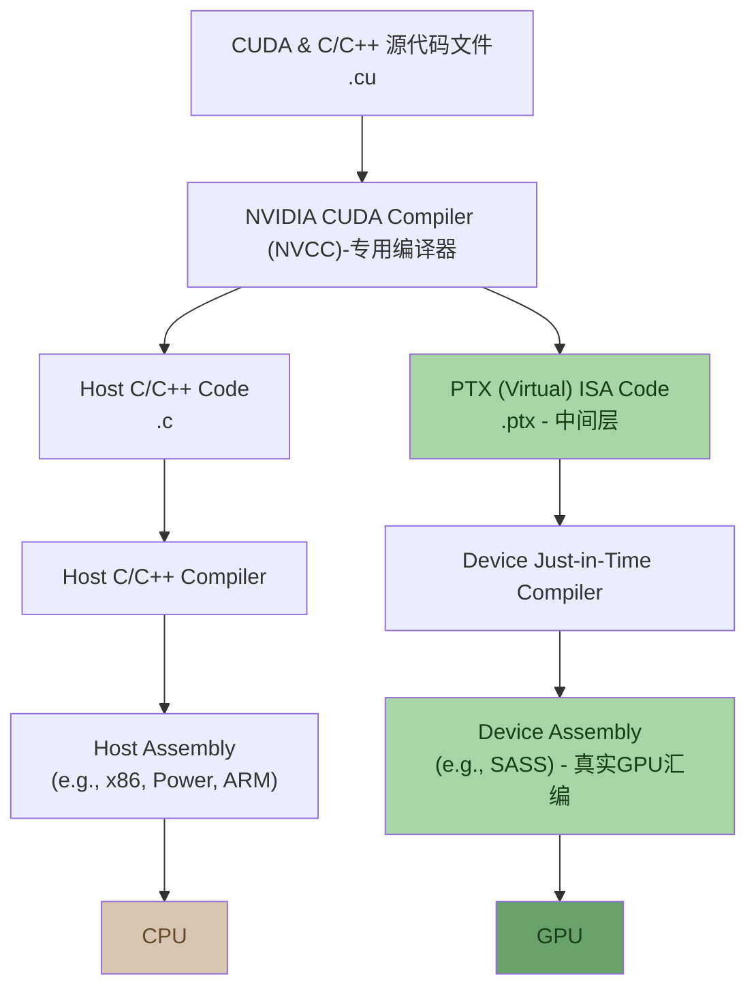

# ai-infra-learn

kernel (算子)：GPU上运行的函数。  通常借助GPU的大量SM (Streaming Multiprocessor) 并行单元来运行。

> 不是操作系统里的kernel

```c
// Kernel function to add the elements of two arrays 
__global__  // 标记后，编译后会被GPU上多线程执行
void add(int n, float *sum, float *x, float *y) {
	for (int i = 0; i < n; i++) 
		sum[i] = x[i] + y[i];
}
```



GPU加速中最常见的任务之一就是GEMM (通用矩阵乘法  GEneral Matrix Multiply)，这几乎是所有深度学习模型计算的底层基石。

Nsight软件：查看NV GPU的profile。


优化 Optimal ：GPU的性能来自并行，但仅有并行并不够。还需要手动优化。

```
┌──────────────────────────────────────────────────────────────┐
│              API 接口：Python / GO / C++ / JS                 │
└──────────────────────────────────────────────────────────────┘
                              ↓
┌──────────────────────────────────────────────────────────────┐
│                         框架层                                │
│                                                              │
│ ┌──────────────────────┐ ┌──────────┐ ┌──────────┐ ┌────────┐ │
│ │      模型转换         │ │ 模型压缩   │ │ 端侧学习  │ │ Others │ │
│ │                      │ │          │ │          │ │        │ │
│ │   模型格式转换         │ │   量化    │ │ 联邦学习  │ │Benchmark││
│ │ -------------------- │ │          │ │ -------- │ │        │ │
│ │       图优化          │ │   蒸馏    │ │ 数据处理  │ │APP Demo│ │
│ │                      │ │          │ │          │ │        │ │
│ │ 算子融合  布局转换      │ │   剪枝   │  │ Trainer  │ │        │ │
│ │                      │ │          │ │          │ │        │ │
│ │ 算子替换  内存优化      │ │  二值化   │ │ Opt/Loss │ │        │ │
│ │                      │ │          │ │          │ │        │ │
│ │         ...          │ │          │ │          │ │        │ │
│ └──────────────────────┘ └──────────┘ └──────────┘ └────────┘ │
│                                                              │
│ ┌──────────────────────────────────────────────────────────┐ │
│ │                       IR / Schema                        │ │
│ └──────────────────────────────────────────────────────────┘ │
└──────────────────────────────────────────────────────────────┘
                              ↓
┌──────────────────────────────────────────────────────────────┐
│                   Runtime (Compute Engine)                   │
│                                                              │
│  ┌──────────┐ ┌──────────┐ ┌──────────┐ ┌──────────┐         │
│  │动态Batch  │ │ 异构执行  │ │ 内存分配  │ │大小核调度   │        │
│  └──────────┘ └──────────┘ └──────────┘ └──────────┘         │
│                                                              │
│       ┌────────────┐   ┌──────────┐   ┌──────────┐           │
│       │ 多副本并行   │   │   装箱   │   │   ...    │           │
│       └────────────┘   └──────────┘   └──────────┘           │
└──────────────────────────────────────────────────────────────┘
                              ↓
┌──────────────────────────────────────────────────────────────┐
│              Kernel (Hardware Level Optimize)                │
│                                                              │
│ ┌────────────────────────────────────┐ ┌───────────────────┐ │
│ │          人工高性能算子               │ │   高性能算子库      │ │
│ │                                    │ │                   │ │
│ │ ┌──────┐ ┌──────┐ ┌──────┐ ┌─────┐ │ │ ┌───────────────┐ │ │
│ │ │ NEON │ │ CUDA │ │Vulkan│ │ TIK │ │ │ │    cuDNN      │ │ │
│ │ └──────┘ └──────┘ └──────┘ └─────┘ │ │ └───────────────┘ │ │
│ │                                    │ │                   │ │
│ │ ┌──────┐ ┌──────┐ ┌──────┐ ┌─────┐ │ │ ┌───────────────┐ │ │
│ │ │ AVX  │ │OpenCL│ │Metal │ │ TVM │ │ │ │    MKLDNN     │ │ │
│ │ └──────┘ └──────┘ └──────┘ └─────┘ │ │ └───────────────┘ │ │
│ └────────────────────────────────────┘ └───────────────────┘ │
└──────────────────────────────────────────────────────────────┘
```

高性能算子层 ：

- 算子优化 
- 算子执行 
- 算子调度

> cuDNN 是 高性能算子库：里面有封装好的kernel，比如GEMM、卷积、attention kernel   （但是闭源，只能靠API调用，无法修改内部实现）
>
> cutlass - 基于C++模板的开源kernel构造框架：允许搭积木，构建自己的kernel。
>
> CUDA, Vulkan等是 人工高性能算子。

可优化对象：

1. CUDA C++代码
2. 直接优化 PTX/SASS （汇编级别）


Triton：可以用Pvthon写出接近cuBLAS性能的kernel，完全不用碰CUDA。是OpenAI开源的一个python DSL (domain specific language)，即语言+编译器。 

核心理念是让研究者只关注高层的并行结构，而将底层调度、指令映射、访存合并等抽象化。


PyTorch作用：大模型训练或推理往往不是由某一个kerinel决定性能，而是由大量kernel组合执行的整体pipeline共同决定。这些kernel之间的组织调度和融合 通常由 PyTorch 等高层框架负责。

- 前端定义模型，然后转成IR / 计算图：PyTorch、TensorFlow、Jax

- IR(中间表示) 包含 计算图， 计算图也是可优化对象：计算图的节点(Node) 表示算子(op)，边(Edge) 表示数据依赖关系。

  fused kernel (算子融合)：如果边连接的两个kernel能fuse成一个，就减少了中间数据写回，减少延迟。

- 后端负责真正生成运行代码：XLA、LLVM - 将中间表示(IR)编译成可在目标硬件(如CUDAGPU或TPU)上执行的机器码

```
┌──────────────────────────────────────────────────────────────┐
│                     深度学习框架 【前端，定义模型】               │
│                                                              │
│       ONNX             TensorFlow             PyTorch        │
└──────────────────────────────────────────────────────────────┘
                              │
                              ▼
┌──────────────────────────────────────────────────────────────┐
│              Language Interface (NeuLang)                    │
└──────────────────────────────────────────────────────────────┘
                              │
                              ▼
┌──────────────────────────────────────────────────────────────┐
│                       Data Flow Graph                        │
│                                                              │
│                 x ─────┐                                     │
│                        ▼                                     │
│                       (*) ─────┐                             │
│                        ▲       ▼                             │
│                 w ─────┘      (+) ─────► y                    │
│                                ▲                             │
│                 b ─────────────┘                             │
└──────────────────────────────────────────────────────────────┘
                              │
                              ▼
┌──────────────────────────────────────────────────────────────┐
│               Graph Optimization (NNFusion)                  │
└──────────────────────────────────────────────────────────────┘
                              │
                              ▼
┌──────────────────────────────────────────────────────────────┐
│                     Kernel Generation                        │
│                                                              │
│ ┌──────────────────┐ ┌──────────────────┐ ┌─────────────────┐ │
│ │ kernel Construct │ │  kernel Tuning   │ │  Sparse Kernel  │ │
│ │                  │ │                  │ │                 │ │
│ │     (Roller)     │ │    (Antares)     │ │    (SparGen)    │ │
│ └──────────────────┘ └──────────────────┘ └─────────────────┘ │
└──────────────────────────────────────────────────────────────┘
                              │
                              ▼
┌──────────────────────────────────────────────────────────────┐
│                 Task Scheduling (Rammer)                     │
└──────────────────────────────────────────────────────────────┘
                              │
               ┌──────────────┼──────────────┐
               │              │              │
               ▼              ▼              ▼
       ┌────────────┐ ┌────────────┐ ┌────────────┐
       │            │ │            │ │            │
       │    CPU     │ │    GPU     │ │    IPU     │
       │            │ │            │ │            │
       └────────────┘ └────────────┘ └────────────┘
```


```
┌──────────────────────────────────────────────────────────────┐
│                   前端编程语言和接口                            │
│             Python / Lua / R / C++ / JavaScript              │
└──────────────────────────────────────────────────────────────┘
                              │
                              ▼
┌──────────────────────────────────────────────────────────────┐
│                        统一表示                               │
│             神经网络模型中间表示：计算图  (Computation Graph )    │
└──────────────────────────────────────────────────────────────┘
                              │
                              ▼
┌──────────────────────────────────────────────────────────────┐
│                        优化层 :                               │
│                       自动微分                                │
│                          ▼                                   │
│                      计算图优化                                │
└──────────────────────────────────────────────────────────────┘
                              │
                              ▼
┌──────────────────────────────────────────────────────────────┐
│                         运行时                                │
│                   计算图调度 & 执行 (Memory Manage)             │
└──────────────────────────────────────────────────────────────┘
                              │
                              ├─────────────────────────┐
                              │                         │
                              ▼                         ▼
┌──────────────────────────────────┐   ┌────────────────────────────────┐
│             底层库                │   │             运行时              │
│                                  │   │                                │
│      内核代码优化与编译             │   │    计算图调度 & 执行              │
│  GPU kernel, auto kernel         │   │       Memory Manage            │
│         generation               │   │                                │
│                                  │   │ ┌────────────────────────────┐ │
│               │                  │   │ │  算子调度策略分配             │ │
│               ▼                  │   │ └────────────────────────────┘ │
│                                  │   │               │                │
│         多硬件支持                │   │               ▼                 │
│    CPU, GPU, RDMA devices        │   │ ┌────────────────────────────┐ │
│                                  │   │ │   算子初始化 (Tiling)        │ │
└──────────────────────────────────┘   │ └────────────────────────────┘ │
                  │                    │               │                │
                  │                    │               ▼                │
                  │                    │ ┌────────────────────────────┐ │
                  │                    │ │    算子内存预分配            │ │
                  │                    │ └────────────────────────────┘ │
                  │                    └───────────────┬────────────────┘
                  │                                    ▼
                  │                    ┌────────────────────────────────┐
                  │                    │             底层库              │
                  └───────────────────►│          Kernel 执行            │
                                       └────────────────────────────────┘
```

