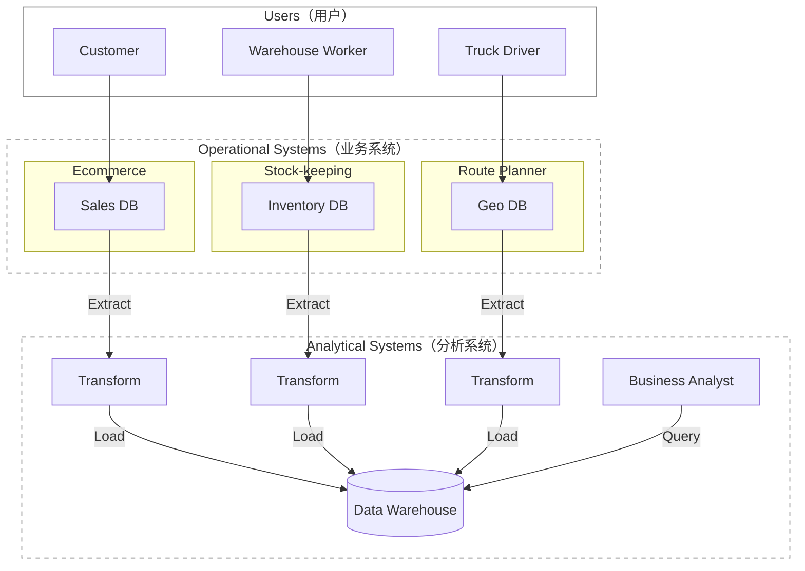

# 《Design Data-Intensive Apps》1-5章- 系统设计书学习

> 中文对照版采用 https://ddia.vonng.com/；  [原版](https://www.oreilly.com/library/view/designing-data-intensive-applications/9781098119058/ch01.html)

## 第一章

数据是许多应用开发的核心。少量数据可以在单台机器上存储和处理，随着数据量或查询速率(rate of queries)增长，数据就需要分布到多台机器上。

- 计算密集型（compute-intensive）系统：如何将 某项极其庞大的计算 并行化 (parallel)
- 数据密集型（data-intensive）应用：重点是 数据管理。关心如何 存储和处理 海量数据(large data volumes)、如何管理 数据变更、如何在 故障(failure)和并发(concurrency) 面前保证 一致性(consistency)，以及如何维持 服务(service) 的高可用性 (available)

许多应用都需要组装以下功能：

- 存储数据，以便自己或其他应用日后能够再次找到（*数据库*，*database*）
- 记住开销昂贵的操作结果，加快读取速度（*缓存*，*cache*）
- 允许用户按关键字搜索数据，或以各种方式过滤数据（*搜索索引*，*search index*）
- 在事件和数据变更发生后立即处理（*流处理*，*stream processing*）
- 定期处理累积的大批量数据（*批处理*，*batch processing*

要学习如何决定采用哪些技术，以及如何组合这些技术。

> 前端 frontend：运行在浏览器中的客户端代码
>
> 后端 backend：处理用户请求的服务器端代码
>
> 最大挑战在后端，因为后端要代表 *所有* 用户管理数据。
>
> 后端代码会在一个或多个数据库中读写数据，也与缓存、消息队列等其他数据系统— *数据基础设施*（*data infrastructure*）交互。
>
> 应用代码通常是 *无状态*（*stateless*）的，即处理完一个 HTTP 请求后，它会忘掉有关该请求的一切。
>
> 任何需要在请求之间持久保存的信息，都必须存放在客户端或服务器端的 数据基础设施中。


企业中会与 data 数据 打交道的几类人群：

*后端工程师*（*backend engineer*）：负责构建 处理数据读取和更新请求的服务。这些服务通常直接面向外部用户，或通过其他服务间接为外部用户提供功能。

*业务分析师*（*business analyst*）：根据组织的活动生成报表(reports)，帮助管理层做出更好的决策 — *Business Intelligence*（BI)

*数据科学家*（*data scientist*）：从数据中寻找新的洞见，或利用数据分析和 ML/AI 构建面向用户的产品功能 — 如搜广推系统、风控系统等

对于 *分析（*analytics*）*行为，通常只查看用户和后端服务 产生的数据，不会修改这些数据。因此分为：

- *事务型系统*（*operational system*）：由 产生数据的 backend services & data infrastructure 组成。应用代码根据用户执行的操作，会读取和修改数据库中的数据。
- *分析型系统*（*analytical system*）：保存事务型系统数据的只读副本(read-only copy)，并针对分析行为所需的数据处理方式进行优化。 服务于业务分析师和数据科学家。

> 这两种系统通常彼此分离。 员工通常只会在其中一种系统中工作。

*数据工程师*（*data engineer*）：集成事务型系统和分析型系统，并负责组织的data infra。

*分析工程师*（*analytics engineer*）：对数据进行建模和转换，使其更便于组织内的业务分析师和数据科学家使用。

### 事务型, 分析型

*事务*（*transaction*）：指构成一个逻辑单元的一组读写操作 (reads & writes)

| 特征属性        | 事务型系统（OLTP, <br />online Transaction Processing ） | 分析型系统（OLAP,<br />online Analytical Processing）        |
| --------------- | -------------------------------------------------------- | ------------------------------------------------------------ |
| 主要 read 模式  | Point queries（按 key 读取少量记录）                     | 聚合大量记录 (扫描海量记录，计算<br />计数、总和或平均值等 聚合统计量) |
| 主要 write 模式 | Create, update,  delete 单条记录                         | 批量导入（ETL）或 事件流                                     |
| 人类用户示例    | web/mobile 应用的最终用户                                | 为决策提供支持的内部分析师                                   |
| 机器用途示例    | 检查某项操作是否获得授权                                 | 检测欺诈或滥用模式                                           |
| 查询类型        | Fixed, predefined by application                         | 分析师可以任意查询 (Arbitrary, ad-hoc exploration)           |
| 数据表示的内容  | 数据的最新状态（current point in time）                  | 一段时间内发生的事件历史                                     |
| 数据集规模      | GB 至 TB                                                 | TB 至 PB                                                     |

> OLAP 中的 *联机*（online）含义并不明确；它大概指查询并非只用于预定义报表。

OLTP 系统主要执行 写在应用代码中的一组固定查询，只在维护或排查故障(troubleshooting)时 偶尔运行一次性自定义查询。 （一般不允许 用户自行编写 SQL 查询并提交给数据库执行）。

分析数据库(analytical databases)：常允许 用户自由手写任意 SQL 查询，也可以通过 **Tableau**、Looker 或 Microsoft **Power BI** 等数据可视化或仪表盘工具(dashboard tool) 自动生成查询。

*产品分析*（*product analytics*）或 *实时分析*（*real-time analytics*）：专为分析型负载（即聚合大量记录的查询）而设计，却嵌入在面向用户的产品的系统。包括 Pinot、Druid 和 **ClickHouse**。

> 这类系统 实时 摄取数据，并针对 低延迟查询响应(low-latency query responses) 进行了优化。
>
> 相比之下，传统的 OLAP（联机分析处理）系统常采用 批处理方式(in batches) 摄取数据，更侧重于 高吞吐量(high-throughput) 的查询处理优化。


### 数仓，数据湖

使用专门的一个独立数据库系统（Data Warehouse）运行分析查询，而不是在同一套数据库上同时进行OLTP 与 OLAP。

为什么不宜让 业务分析师和数据科学家 直接查询这些 OLTP 系统：

- 所需数据可能散落在多个事务型系统(OLTP)中，很难通过一条查询组合这些数据集；该问题称为 *数据孤岛*（*data silo*）。
- 适合 OLTP 的模式(schemas) 和 数据布局 不太适合分析(analytics)。
- 分析查询的开销可能很高；在 OLTP 数据库上运行会影响其他用户的性能。
- 出于安全或合规方面的考虑，OLTP 系统可能位于一个不允许用户直接访问的独立网络中。

*数据仓库 （Data Warehouse）*  ：是一个独立的数据库，分析师可以尽情查询，而不会影响 OLTP 系统的运行。

它的存储方式往往与 OLTP 数据库截然不同，以便针对分析中常见的查询类型进行优化。


*Extract–Transform–Load (ETL)*：把数据送入数据仓库的这一过程：数据仓库保存着企业各个 OLTP 系统中数据的只读副本(read-only copy)。数据先从 OLTP 数据库中 extract 出来（通过定期data dump 或 连续的stream of updates），再 transform 成 analysis-friendly schema 并且 进行 clean up，最后 load 进入数据仓库。

有时也会变成 先 load 进入数据仓库，再在数据仓库内 transform；这便成了 *ELT* 。



有时，ETL 流程的数据源是外部 SaaS 产品，例如客户关系管理（CRM）系统；此时只能通过软件供应商的 API 获取数据，然后把这些外部系统的数据导入自己的数据仓库。针对 SaaS API 的 ETL，通常由 Fivetran、Singer 或 AirByte 等专业数据连接器服务实现。

有些数据库系统提供 *hybrid transactional/analytical processing 混合 事务/分析 处理*（HTAP），目标是在单个系统中同时支持 OLTP 和分析，无需通过 ETL 转换。  但许多 HTAP 系统内部仍由一个 OLTP 系统和一个独立的分析系统耦合而成，只是共同隐藏在统一接口。

HTAP 并不能取代数据仓库。它适合的是另一类场景：同一个应用既要运行 扫描大量数据行的分析查询，又要 低延迟地读取和更新单条记录。例如，欺诈检测。

良好实践——事务型系统与分析型系统的分离：每个事务型系统各自拥有数据库，可能产生数百个独立的事务型数据库；企业通常只设一个数据仓库，以便业务分析师在一条查询中组合多个事务型系统的数据。


数据仓库通常采用 *relational* 数据模型，并通过 SQL 查询，很适合业务分析师所需的查询，却不太适合数据科学家的需求：

- 要把数据转换成适合训练 ML model 的形式。通常要把数据库 表中的行列 转换为 vector or matrix of numerical values *(称为 特征 feature）*。
- 对文本数据（例如商品评论）应用 NLP 技术，尝试从中提取结构化信息(structured information)（例如作者表达的情绪）。同样，也可能要用 CV 技术从照片中提取结构化信息。

> *特征工程 feature engineering* ：为了能够最大化 trained model 的性能，来进行以上数据转换的过程。通常需要编写难以用 SQL 表达的自定义代码。

数据科学家不愿在 数据仓库这样的关系数据库 中工作，更喜欢 pandas、scikit-learn 等 Python 数据分析库，R 等统计分析语言，以及 Spark 等分布式分析框架。

组织需要以适合数据科学家使用的形式提供数据 ——  *数据湖*（*data lake*）


 *数据湖*（*data lake*）：一个集中的(centralized) 数据存储库(data repository)，保存一切可能对分析有用的数据副本(copy of any data)，这些数据通过 ETL 流程从事务型系统(operational systems) 取得。

与数据 warehouse的区别：数据 lake 只保存文件，并不强制规定 file format，data model, or schema。

> 数据湖中的文件可以是一批数据库记录，以 Avro 或 Parquet 等文件格式编码；
>
> 也完全可以是文本、图像、视频、稀疏矩阵、特征向量、基因组序列，或任何其他类型的数据。

数据湖不仅更加灵活，而且往往比 relational data storage 更便宜，因为它可以使用 object stores 等廉价通用的文件存储。

*数据管道*（*data pipeline)*： ETL 流程的泛化。

某些情况下，数据湖成为 operational systems 通往data warehouse 途中的一站。数据湖按照“原始(raw)”形态保存 operational systems产生的数据，不把它们转换成关系型数据仓库的模式。好处是：每个数据消费者都可以把原始数据转换成最适合自己需求的形式 —— *寿司原则*（*sushi principle*）：“原始数据更好”


*数据湖仓*（*data lakehouse*）：直接针对数据湖中的文件运行典型的数据仓库 workloads（SQL 查询和业务分析），并与数据科学和机器学习 workloads 并存。它需要在数据湖的文件存储之上增加 query execution engine 和 metadata 层（例如 schema management）。  **Apache Hive**、**Spark SQL**、Presto 和 Trino 都采用了这种方法。


组织也越来越重视分析系统与数据管道的管理和运维，如遵守 GDPR、CCPA 等法规。

有时，分析系统的输出还会提供给事务型系统，这个过程称为 *反向 ETL*（*reverse ETL*）。例如，在分析系统中训练好的 ML model 可以部署到生产环境。可以借助 TFX、Kubeflow 或 MLflow 等工具部署到事务型系统。


*记录系统*（*system of record*）/ *权威数据源*（*source of truth*）：保存某类数据的 权威(authoritative) 或 规范（canonical）版本。新数据被首先写入这里。每项事实只表示一次，通常采用 *规范化*（*normalized*）表示。如果其他系统与记录系统的数据不一致(discrepancy)，那么应以记录系统中的值为准。

*衍生数据系统*（*derived data system*）：衍生系统中的数据，是以另一个系统中的现有数据为基础，经过某种转换或处理而得到的结果。衍生数据即使丢失，也可以从原始数据源重新创建。   比如 缓存cache、在数据集上训练的模型。 

衍生数据是 *冗余*（*redundant*）的，因为它复制了现有信息。但你可以从同一个数据源衍生出多个不同的数据集，从不同“视角”观察数据。

一个系统究竟属于哪一类，取决于它在应用中的用法，而不是采用了什么工具。


### 云服务

软件由谁来构建，又由谁来部署。两项工作都可以按不同程度外包：

```
In-house Software          Off-the-shelf Software         Off-the-shelf Software
In-house Operations        In-house Operations           Outsourced Operations
(e.g. Application Code)    (e.g. Self-hosted DB on IaaS)  (e.g. Cloud Services/SaaS)
←──────────────────────────────────────────────────────────────────────────→

More Control                                                    Less Control
Greater Investment                                            Lower Investment
```

使用云服务(cloud service) ：把软件的运维外包(outsource)给云服务商。

云服务适合：不必专门考虑infra的运维、系统负载随时间大幅波动可以弹性计算资源。

云服务最大的缺点——你无法掌控它：

- 如果服务缺少需要的功能，只能等供应商添加；通常无法自己动手实现。
- 如果服务宕机，只能等它恢复。
- 如果你的某种使用方式触发了缺陷或性能问题，诊断起来会非常困难。
- 如果服务停止运营、价格高到无法接受，或供应商以你不喜欢的方式改动产品，也只能任其摆布——产生了供应商锁定(vendor lock-in) 问题。
- 如果云服务提供商位于其他国家，与你所在国发生政治冲突，可能因遭受制裁而无法继续使用。
- 你必须相信云服务商能够保护数据安全，这可能会增加遵守隐私和安全法规的难度。


Cloud Native 系统架构

*云原生*（*cloud-native*）：专为利用云服务优势而设计的架构。

| 类别        | 自托管(self-hosted) 系统        | 云原生系统                                                 |
| ----------- | ------------------------------- | ---------------------------------------------------------- |
| 事务型/OLTP | **MySQL**、PostgreSQL、MongoDB  | AWS Aurora 、Azure SQL DB Hyperscale、Google Cloud Spanner |
| 分析型/OLAP | Teradata、ClickHouse、**Spark** | **Snowflake**、Google BigQuery、Azure Synapse Analytics    |

在云中，软件可以运行在基础设施即服务（IaaS）环境里，使用一台或多台虚拟机VM（也称 *实例*，*instance*），每台实例分配一定数量的 CPU、内存、磁盘和网络带宽。与物理机器相比，云实例的开通速度更快。

云原生服务的关键思想：不仅使用操作系统管理的计算资源，还要在低层云服务的基础上构建更高层的服务。

- Amazon S3 (Simple Storage Service)、Azure Blob Storage 和 Cloudflare R2 等 *对象存储*（*object storage*）服务用于保存大型文件。它们的 API 比普通文件系统更受限，只提供基本的文件读写；

  但好处是隐藏了底层物理机器，服务会自动把数据分布到许多机器上。

- 许多其他服务又建立在对象存储和其他云服务之上。例如，Snowflake 是一种云端分析数据库（数据仓库），依靠 S3 存储数据；还有一些服务进一步构建在 Snowflake 之上。


**存储与计算 分离**

云中的计算实例（虚拟机）也可以连接本地磁盘，但云原生系统通常更愿意把它们当作临时缓存，而不是长期存储。作为替代，云服务提供虚拟磁盘(virtual disk)存储，可以从一个实例卸载，再挂载到另一个实例上，例如 Amazon EBS、Azure 托管磁盘和 Google Cloud 持久磁盘。

这种虚拟磁盘并不是真正的物理磁盘，而是由另一组机器提供的云服务，用来模拟磁盘( *块设备*（*block device*）)的行为，其中每个块通常为 4 KiB。  但块设备模拟会引入额外开销；且虚拟块设备上的每次 I/O 实际上都是一次网络调用。

因此，云原生服务通常避开虚拟磁盘，转而建立在 针对特定工作负载(workloads)优化 的 专用存储服务(dedicated storage services)上。S3 等对象存储服务适合长期保存较大的文件，大小从数百 KB 到数 GB 不等。数据库中的单行或单个值通常远小于这个范围；

因此，云数据库通常在一个独立服务中管理较小的值，并把包含许多个值的较大数据块(data blocks)存入对象存储。

- 传统系统架构中，同一台计算机同时负责存储（磁盘）和计算（CPU 与内存）
- 云原生系统中，这两项职责在一定程度上相互分离，被 *解耦*（*disaggregated*）。例如，S3 只负责保存文件；如果要分析其中的数据，就必须在 S3 之外运行分析代码 (通过网络传输数据)。

云原生系统采用 *多租户*（*multitenant*）模式：它不为每个客户单独分配一台机器，而是由同一项服务在共享硬件上处理多个客户的数据和计算。


**云时代的运维(Operations)**

*数据库管理员*（DBA）或 *系统管理员*（sys admin）：传统上，管理组织 服务器端 数据基础设施的人员。

*DevOps / SRE (Site reliability engineers)* ：把软件开发与运维角色融入同一个团队，让团队共同负责后端服务和数据基础设施。 

运维的职责：确保服务可靠地交付(reliably delivered)给用户，包括配置基础设施和部署应用；同时保障生产环境稳定(stable production environment)，包括监控和诊断任何可能影响可靠性的问题。

许多云服务通过 API 隐藏了实际承载服务的一台台机器，采用 *按量计费*（*metered billing*），自带高可用性。

- 基础设施公司的运维团队专攻如何面向大量客户提供可靠服务；
- 云服务客户则力求把投入基础设施的时间和精力降到最低

DevOps/SRE 理念更强调：

- 自动化(automation)——采用可重复的流程，而不是手工执行一次性任务(one-off jobs)；
- 采用临时性的(ephemeral) 虚拟机和服务，而不是长时间运行的服务器(long-running servers)；
- 支持频繁更新应用；
- 从事故中吸取教训；
- 即使人员来去更替，也要保留组织对系统的知识

### 分布式系统

*分布式系统*（*distributed system*）：由多台机器通过网络通信(communicating via a network) 而构成的系统。

 *节点*（*node*）：参与分布式系统的每个进程(process)。

为什么要使用：

- 一项应用涉及两个或更多交互的用户，而每个用户都使用自己的设备，那么这个系统不可避免地是分布式的
- 数据存储在一个服务中，却要由另一个服务处理，就必须通过网络把数据传输  （云原生系统、微服务都是分布式的）
- 用多台机器提供冗余(redundancy)，保证容错(Fault tolerance) ，高可用性(high availability)
- Scalability，把负载分散到多台机器上。
- Latency，全球多个区域部署服务器，让每个用户都由地理位置较近的服务器提供服务。
- Elasticity，云端部署可以随着需求扩大或缩小，让你只为正在使用的资源付费。
- 系统的各个部分可以采用与各自工作负载相匹配的硬件。
- 一项服务的用户分布在多个这样的司法管辖区，就不得不把用户数据分散到多个地点的服务器上。
- 选择可再生电力充足的时间和地点，并避开电网负荷紧张的时候。

分布式系统的缺点和注意问题：

- 每一个经过网络的请求和 API 调用，都必须面对失败的可能——网络可能中断，服务可能过载或崩溃，任何请求都有可能超时而收不到响应
- 调用另一个服务仍然远远慢于在同一进程中调用函数
- 处理海量数据时，与其把数据从存储位置传到另一台机器上处理，可能不如把计算带到已经保存数据的机器上来得快
- 节点更多也不一定更快
- 分布式系统往往很难排查故障：如果系统响应缓慢，怎样才能找出问题在哪里？
- 当每个服务都有自己的数据库时，如何保持不同服务之间的数据一致。

*可观测性*（*observability*）：用于诊断(diagnosing) 分布式系统问题的技术。它收集系统的执行数据，并允许人们查询这些数据，从而既能分析高层指标，也能追查单个事件。 **OpenTelemetry**、Zipkin 和 **Jaeger** 等 *追踪*（*tracing*）工具可以记录哪个客户端为了什么操作调用了哪个服务器，以及每次调用花了多长时间。

### **Microservices(微服务) & Serverless(无服务器)**

*面向服务架构*（SOA, service-oriented architecture）：划分为客户端(client) 和服务器(server) ，由客户端向服务器发送请求，使用HTTP来通信；同一个进程既可以是服务器（处理传入的请求），也可以是客户端（向其他服务发出请求）。

演化为 *微服务*（*microservices*）架构：每项服务(service) 都有明确的用途（例如 S3 的用途就是文件存储），服务通过 API 向客户端开放能力，由客户端经网络调用；每项服务由一个团队负责维护。这样复杂应用就可以被拆分(decomposed) 成多项相互交互的服务，分别由不同团队管理。

云原生系统大量采用服务拆分，但本地部署(on-premises) 的系统同样可以采用面向服务的方法。

微服务优点：

- 各项服务可以独立更新，减少团队之间的协调(coordination effort)
- 每项服务可以获得符合自身需要的硬件资源
- 实现细节隐藏在 API 后面，服务负责人可以自由改变实现，而不影响客户端
- 数据存储方面，通常每项服务都有自己的数据库，服务之间不共享数据库

存在的问题：

- 服务多了本身也会滋生复杂度(breed complexity)

- 每项服务都需要相应基础设施，用来部署新版本、根据负载调整硬件资源、收集日志、监控服务健康状况。

  Kubernetes 等 *编排*（*orchestration*）框架为这类基础设施提供了基础能力，因此成了部署服务的常用方式。

- 开发过程中测试一项服务也可能很麻烦，因为它所依赖的其他服务必须一并运行

- 微服务 API 也很难演化；随着业务需求改变，开发者或许想要增删 API 字段，但这可能导致客户端出错。

  OpenAPI 和 gRPC 等 API 描述标准有助于管理客户端 API 与服务器 API 之间的关系。

微服务主要是让不同团队无需彼此协调，也能独立推进工作。对大公司很有价值。


*无服务器*（serverless），又称 *函数即服务*（FaaS, function as a service）：另一种服务部署方式。把基础设施管理进一步外包给云服务商，由云服务商根据发往服务的请求，自动分配和释放硬件资源。 每次执行无服务器函数仍然要用到一台服务器，只是下一次执行可能换到另一台。

云存储用按量计费取代了容量规划（提前决定购买多少磁盘），无服务器模式也把按量计费带到了代码执行：你只需为应用代码实际运行的时间付费，不必提前配置资源。

### **云计算 & 超算**

构建大规模(large-scale) 计算系统除了*云计算 (cloud computing)*，另一条路线是 *高性能计算*（HPC, high-performance computing），也称为 *超级计算*（*supercomputing*）。

- 超级计算机通常用于计算密集型的科学计算任务，例如天气预报、气候建模、分子动力学（模拟原子和分子的运动）、复杂优化问题，以及求解偏微分方程。

  云计算则更常用于在线服务、业务数据系统，以及其他需要以高可用性响应用户请求的系统。

- 超级计算机通常运行大型批处理作业(large batch jobs)，并不时把计算状态作为检查点写入磁盘。如果某个节点发生故障，一种常见做法是直接停止整个集群的工作负载，修复故障节点，再从最近的检查点重新开始计算。

  云服务通常不宜这样停掉整个集群，因为服务必须持续响应用户，尽量减少中断。

- 超级计算机的节点通常通过共享内存(shared memory) 和 远程直接内存访问（RDMA）通信，既有高带宽(high bandwidth)，又有低延迟，但前提是系统用户彼此高度信任。

  在云计算中，网络和机器常由互不信任的组织共享，因此需要更强的安全机制，例如资源隔离(resource isolation)（使用虚拟机等）、加密(encryption) 和认证(authentication)。

- 云数据中心网络通常以 IP 和以太网为基础，采用 Clos 拓扑来提供较高的对分带宽——这是衡量网络整体性能的常用指标。

  超级计算机则常采用专门的网络拓扑，例如多维网格和环面；对于通信模式已知的 HPC 工作负载，这类拓扑可以提供更好的性能。

- 云计算允许节点分布在多个地理区域；

  超级计算机通常假定所有节点都彼此邻近。


## 第二章

*功能需求（functional requirements）*：应用必须提供的功能——需要哪些页面(screen)和按钮，每项操作要完成什么，才能实现软件的目的。

*非功能性需求（nonfunctional requirements）*：应用应当快速、可靠(reliable)、安全、符合法律规定(legally compliant)，而且易于维护。这些要求未必会明确写下来。

- 如何定义和衡量系统的 *性能 (performance)*
- 服务 *可靠*（*reliable*）意味着什么 —— 出了问题，仍能继续正确工作
- 系统负载增长，能否高效增加计算能力，使系统具备 *可伸缩性(scalability)*
- 让系统在长期使用中更易维护

### case study

假设你的任务是实现一个类似 X（原 Twitter）的社交网络，用户可以发帖，也可以关注其他用户。假设用户每天发布 5 亿条帖子，平均每秒 5,700 条；偶尔，发帖速率会飙升至每秒 150,000 条。再假设每位用户平均关注 200 人，也有 200 名关注者。

假设这个社交网络需要支持的主要读操作是 *首页时间线（home timeline）*，用来展示你所关注的人最近发布的帖子。  把所有数据都保存在关系数据库中：

```
Current user: 17055506
        v
follows table
| follower_id | followee_id (被关注者) |
| 17055506    |     12      |
                  v
posts table
| id | sender_id |        text              |  timestamp  |
| 20 | 12        | just setting up my twttr |  1142974214 |
          v
users table
| id | screen_name | profile_image |
| 12 | jack        | 1234567.jpg   |
```

假设某人发帖之后，希望其关注者能在 5 秒内看到：*轮询（polling）* —— 只要用户在线，客户端就每隔 5 秒重复执行一次查询。   但是如果同时在线的用户有 1000 万，就意味着每秒要执行 200 万次查询。且查询本身开销不小，数据库每秒要查询某个发帖者的近期帖子 4 亿次。

优化思路🔔：由服务器把新帖子主动推送(push) 给当前在线的关注者 （而不是轮询）。其次，可以预先计算上述查询的结果，使首页时间线请求直接由缓存(cache) 提供。

为每位用户保存一个数据结构，其中装着他们的首页时间线，即他们所关注的人最近发布的帖子。每当有人发帖，我们就找出他的所有粉丝，把这条帖子插入每位粉丝的首页时间线。 若要接收时间线上的新帖通知，用户客户端只需订阅不断加入其首页时间线的帖子流。

> 首页时间线是需要随之更新的 *衍生数据（derived data）*。
>
> ***扇出（fan-out）***：当一个初始请求**引发多个下游(downstream)请求**时，表示**请求数量被放大的倍数(factor)**。

```
User makes post
      v
All posts: [T8][T7][T6][T5][T4][T3][T2][T1]
      |
      |  Fan-out: deliver post to each follower
      |
      ├────────→ Recipient 1: [T7][T5][T3][T1]    ← Get home timeline (website, API)
      ├────────→ Recipient 2: [T8][T6][T5]        ← Get home timeline
      └────────→ Recipient 3: [T8][T7][T5][T4][T3]← Get home timeline
```

以每秒 5,700 条帖子的速率计算，如果每条帖子平均要送达 200 名关注者（扇出系数 = 200），每秒就要完成略多于 100 万次首页时间线写入。

如果某个特殊事件使发帖速率骤增(spike) ，无须立刻完成所有时间线投递：先把投递任务放入队列(enqueue) ，并允许帖子等待一段时间才会出现在关注者的时间线上。 即使出现这种负载高峰，时间线仍可快速加载，因为读取只需访问缓存。

 *物化（materialization）* ：将原本需要实时计算或查询的结果，提前计算并存储起来。

这里的时间线缓存就是一个 *物化视图（materialized view）*，加快了读取，代价则是写入时要做更多工作。

大多数用户的写入成本不高，但极端情况下：

- 关注数过多，导致写入某个用户物化时间线的速率会很高，可以丢弃其中一部分时间线写入。
- 一位拥有海量关注者的名人发帖，要把这条帖子插入数百万人的首页时间线，不能丢弃部分。可以选择将其单独存储，等读取时再与物化时间线合并。而不是按常规插入到百万人。

### 性能指标

*响应时间（response time）*：从用户发出请求到收到所需响应所经过的时间(elapsed time) 。计量单位是秒。

*吞吐量（throughput）*：系统每秒处理的请求数或数据量。 计量单位是 xxx per second.

对于给定的硬件资源，系统能处理的吞吐量存在的上限，就是 *最大吞吐量*（*maximum throughput*）

请求吞吐量较低时，服务的响应时间也很短；随着负载增大，响应时间随之上升。这是 *排队*（*queueing*）造成的.

过载(overload) ：当系统濒临过载、吞吐量已被推到极限附近时，有时会陷入恶性循环(vicious cycle) 。

- *重试风暴（retry storm）*：等待处理的请求排起长队，响应时间可能因此增长到客户端超时并重发请求。请求速率随之进一步上升。
- *亚稳态故障（metastable failure）*：负载随后下降，系统也可能一直停留在过载状态，直到重启或以其他方式重置。

解决措施：在客户端逐渐延长并随机扰动连续重试之间的等待时间（*指数退避*，*exponential backoff* )；采用*熔断器*（*circuit breaker*）或 *令牌桶*（*token bucket*）算法，暂时停止向最近曾返回错误或发生超时的服务发送请求；服务器在察觉自己接近过载时主动拒绝请求（*负载卸除*，*load shedding*)，并在响应中要求客户端降低发送速率（*背压*，*backpressure* )。  排队算法和负载均衡(load balance) 算法的选择同样会产生影响

各项性能指标中，用户通常最关心**响应时间**；吞吐量则决定了所需的计算资源（例如服务器数量）。如果增加计算资源能够显著提高系统的最大吞吐量，我们就称这个系统具有 *可伸缩性（scalability）*。


- *响应时间*（*response time*）：客户端看到的时间，其中包括系统各处产生的全部延误。
- *服务时间*（*service time*）：服务真正用于处理用户请求的时间。

- 延迟(latency) ：泛指请求没有得到实际处理的时间，也就是请求处于 *潜伏（latent）* 状态的时间。

  *网络延迟*（*network latency*）/ *网络时延*（*network delay*）是请求和响应在网络中传输所花的时间。

- *排队延迟*（*queueing delay*）可能发生在流程中的多个位置。

```
             Make Request                               Receive Response
User ────────●─────────────────────────────────────────────────────●→ Time
                \                                                ↗
                  \ request                            response /
                     ↘                                     /
Service ─────────────────●───────── ┌──────────┐─────────●──────────→ Time
                                    │Processing│
                                    └──────────┘
             |           |          |          |        |         |
             | Network   | Queueing |Service   |Queueing| Network |
             | Latency   | Delay    | Time     |        | Latency |
             |───────────|──────────|──────────|────────|────────|
             |<──────────────── Response Time ──────────────────>|
```

即使反复发送同一个请求，每次的响应时间也可能相差很大。许多因素都会带来随机的额外延迟。

响应时间的波动很大一部分往往来自排队延迟。排队延迟不属于服务时间。由于服务器同时能处理的任务数量有限，只需少数几个慢请求，就足以阻碍后续请求，这种现象称为 *队头阻塞（head-of-line blocking）*

每次请求的响应时间都不一样，因此应将其视为一组可测量数值的 *分布（distribution）*。

大多数请求都相当快，但偶尔会出现耗时长得多的 *异常值*（*outlier*）。网络延迟的变化也称为 *抖动（jitter）*。

- 服务通常会报告 *平均*（*mean / average*）响应时间，即 *算术平均值*（*arithmetic mean*）。有助于估算吞吐量的上限。
- 通常，采用 *分位数（percentile）* 更合适。将响应时间从快到慢排列，*中位数*（*median*）就是位于正中间的值。例如，如果响应时间的中位数是 200 毫秒，就意味着一半请求用时不到 200 毫秒.
  - 50th percentile  (p50) / Median：50% 的请求响应时间小于或等于该值。
  - p95 ：95% 的请求响应时间小于或等于该值 。  （弄清异常值究竟有多糟）
  - p99 ：99% 的请求响应时间小于或等于该值。
  - p999 ：99.9% 的请求响应时间小于或等于该值。

响应时间的高分位数也称为 *尾延迟（tail latencies）*，会直接影响用户对服务的体验。因为响应最慢的客户往往是在账户中积累了最多数据的人，也最有价值。

*尾部延迟放大（tail latency amplification）*：当一次请求需要多个后端调用时，只需一个慢调用，就会拖慢整个最终用户请求。

分位数经常出现在 *服务级别目标（SLO, service level objectives）* 和 *服务级别协议（SLA, service level agreements）* 中，用来规定服务应达到的性能和可用性。

> 持续计算响应时间和P指标：可以维护一个滚动窗口，记录最近 10 分钟内所有请求的响应时间；每隔一分钟，计算窗口中各个数值的中位数和其他分位数，并把这些指标绘制在图表上。
>
> 简单的实现是保存时间窗口内所有请求的响应时间列表，并每分钟对它排序一次。用于估算分位数的开源库包括 HdrHistogram、t-digest、OpenHistogram 和 DDSketch。
>
> 聚合响应时间数据的正确方法是把直方图(histogram) 相加 。

### 可靠性与容错

对可靠软件的典型期望包括：

- 应用程序表现出用户所期望(user expected) 的功能。
- 允许用户犯错，或以出乎意料的方式使用软件。
- 在预期的负载和数据量(expected load and data volume) 下，性能足以满足所需的使用场景。
- 系统能防止未经授权的访问和滥用(unauthorized access and abuse)。

*可靠性（reliability）* ：即使出了问题，也能继续正确工作。

- *故障（fault）*：系统的某个 *部分* 停止正常工作。 如单台机器崩溃。
- *失效（failure）*：*整个系统* 停止向用户提供所需的服务，即 系统没有达到服务级别目标（SLO）。

*容错的（fault-tolerant）*：如果某些故障发生时，系统仍能继续向用户提供所需服务。

*单点故障（SPOF, single point of failure）*：系统无法容忍(tolerate) 出现故障的某个部分，即如果该部分故障，会导致整个系统失效。

容错能力总是针对特定类型、特定数量的故障而言。要求系统容忍任意数量的故障没有意义。

在这类容错系统中，通过故意触发故障来 提高故障率 有时反而是合理的，例如毫无预警地随机杀死某个进程。这称为 *故障注入（fault injection）*。 故意制造故障，可以让容错机制不断得到演练和检验。

比起预防故障，我们通常更倾向于容忍故障，但有时预防确实胜于治疗。

系统失效——硬件故障：大规模系统里，硬件故障发生得足够频繁，已经成了系统正常运行的一部分。

- RAM 中的数据也可能损坏，原因既可能是宇宙射线等随机事件，也可能是永久性的物理缺陷。
- 机械硬盘、SSD故障、CPU核心偶尔算错
- 电源、RAID 控制器和内存模块等其他硬件组件也会发生故障

解决——通过冗余(redundancy) 容忍硬件故障：为各个硬件组件增加冗余，以降低整个系统的失效率。例如，磁盘可以组成 RAID（把数据分散到同一台机器的多块磁盘上)；服务器可以配备双路电源和可热插拔的 CPU。

当各个组件的故障彼此独立（一项故障的发生不会改变另一项故障发生的概率）时，冗余最有效。

采用分布式系统更具优势，可以容忍整个数据中心中断，云系统往往不那么强调单台机器的可靠性，而是力求在软件层面容忍节点故障，让服务实现高可用。

*滚动升级（rolling upgrade）*：多节点容错系统可以逐个重启节点来安装补丁，不影响向用户提供服务。

系统失效——软件故障：软件故障往往高度相关，因为许多节点通常运行同一套软件。

- 一个软件缺陷在特定情况下导致所有节点同时失效。
- 某个失控进程耗尽 CPU 时间、内存、磁盘空间、网络带宽或线程等共享而有限的资源。
- 不同系统之间的交互产生涌现行为，而每个系统单独测试时都不会出现这种行为。
- 发生级联失效：一个组件的问题导致另一个组件过载并变慢，后者继而又拖垮下一个组件。

引发这类软件故障的缺陷往往会潜伏很久，直到一组不同寻常的条件将其触发。

人因错误：

*无责复盘（blameless postmortem）* ：事故发生后，鼓励参与者毫无保留地讲清事情经过，不必担心受到惩罚.

### scalability

系统退化(degradation) 的一个常见原因是负载增加。

*可伸缩性（scalability）*：描述系统应对负载增长的能力。

- “如果系统按某种方式增长，我们有哪些应对选项？”
- “我们如何增加计算资源来承载额外负载？”
- “按当前的增长预期，什么时候会达到现有架构的极限？

描述系统当前的 *负载(load)* ：通常是某项吞吐量指标，例如服务每秒收到的请求数、每天新增多少 GB 数据。有时，关心的是某个变量的峰值，例如同时在线数。

有时平均情况最重要，有时瓶颈却由少数极端情况主导。

- 以某种方式增加负载，而系统资源（CPU、内存、网络带宽等）保持不变，系统性能会受到什么影响？
- 以某种方式增加负载，而你希望性能保持不变，需要增加多少资源？

我们的目标是在满足 SLA 性能要求的同时，尽可能降低系统的运行成本。

*线性可伸缩性*（*linear scalability*）：如果资源增加一倍，系统能在性能不变的情况下处理两倍负载。

更常见的情况是，成本增长得比线性更快。

增加服务硬件资源：

*纵向伸缩（vertical scaling） / 向上伸缩（scaling up)* ：把服务迁移到更强大的机器上，买到（或在云上租用）配有更多 CPU 核心、更大 RAM 和更多磁盘空间的机器。

 *共享内存架构（shared-memory architecture）*：在单台机器上运行多个进程或线程，可以获得并行处理能力。但问题在于，成本增长得比线性更快。

*共享磁盘架构（shared-disk architecture）*：多台机器分别拥有独立的 CPU 和 RAM，却把数据存储在共同访问的一组磁盘阵列中，机器与磁盘通过高速网络连接，例如 *网络附加存储（NAS, network-attached storage）* 或 *存储区域网络（SAN, storage area network）*。

*水平伸缩（horizontal scaling）/ 向外伸缩（scaling out）/ 无共享架构（shared-nothing architecture）*：采用包含多个节点的分布式系统，每个节点都拥有自己的 CPU、RAM 和磁盘；节点之间的一切协调，都通过普通网络在软件层完成。 已经广受欢迎：

- 有望实现线性伸缩；可以使用任何性价比最好的硬件，在云端尤其如此。
- 负载增减时更容易调整硬件资源；还可以把系统分布到多个数据中心和地域。
- 缺点则是必须显式进行分片，要面对分布式系统的全部复杂性。


大规模系统的架构通常高度依赖具体应用，没有*万金油（magic scaling sauce）*的可伸缩架构。

适合某个负载水平的架构，多半应付不了十倍于此的负载。每当负载增加一个数量级，就需要重新考虑架构。

通用原则：把系统拆分成较小的组件，使它们大体上能够彼此独立地运行。这是微服务、分片、流处理和无共享架构背后的共同原则。  挑战在于判断哪些东西应该放在一起，哪些东西应该拆开。

不要让系统变得比必要的更加复杂。如果单机数据库足以完成任务，它很可能比复杂的分布式配置更可取。

### 可维护性 Maintainability

软件不会磨损，不过，应用程序的需求经常变化，软件运行的环境也会变化，且软件中总有缺陷需要修复。

软件的大部分成本不在最初的开发阶段，而在持续的维护阶段。

维护这样的 *遗留（legacy）* 系统既是人的问题，也是技术问题。

设计软件时就应该考虑维护问题：

- 可运维性（operability）：便于组织保持系统平稳运行。
- 简单性（simplicity）：采用人们熟知且前后一致的模式和结构，避免不必要的复杂度，使新工程师也能轻松理解系统。
- 可演化性（evolvability）：便于工程师将来修改系统，在需求变化时调整和扩展系统，以适应事先没有预料到的使用场景。

要实现可靠运维，人的流程至少与软件工具同等重要。自动化并非总是越多越好。一定程度的自动化依然很重要，最佳平衡点则取决于具体应用和组织的情况。

- 允许监控工具检查系统的关键指标，并支持可观测性工具，以便深入了解系统运行时的行为。
- 避免依赖任何一台机器，使机器可以下线维护，而整个系统仍能不间断地运行。
- 提供良好的文档和易于理解的操作模型（“如果我做 X，就会发生 Y”）。
- 提供良好的默认行为，同时允许管理员在必要时覆盖默认设置。
- 在适当的时候自动修复，同时也允许管理员在必要时手动控制系统状态。
- 表现出可预测的行为，尽量避免出人意料。

随着项目不断扩大，代码往往变得非常复杂，难以理解，最终变成 *大泥球（big ball of mud）*。

理复杂度最好的工具之一是 *抽象（abstraction）*：可以借助 设计模式（design pattern） 和 领域驱动设计（DDD, domain-driven design）等方法来构建抽象。

系统的需求总在变化：*敏捷（Agile）* 工作模式为适应变化提供了框架。例如 *测试驱动开发（TDD, test-driven development）*和*重构(refactoring)*。

*可演化性（evolvability）*——数据系统层面的敏捷性(agility)：松耦合(Loosely coupled)、简单的系统通常比紧耦合、复杂的系统更容易修改。

尽量减少不可逆性(irreversibility)，可以提高系统的灵活性。

## 第三章.Data model

应用使用层层叠加的数据模型构建，每层用低一层数据模型来表示：

- 一名应用开发人员，你观察现实世界，并采用对象或数据结构，以及操控那些数据结构的 API 来进行建模。那些结构通常是特定于应用程序的。
- 要存储那些数据结构时，你可以利用通用数据模型来表示它们，如 JSON 或 XML 文档、关系数据库中的表，或者图中的顶点和边。
- 构建数据库软件的工程师决定如何以内存、磁盘或网络上的字节来表示文档、关系或图数据。这类表示形式使数据有可能以各种方式来查询、搜索、操纵和处理。
- 更低的层次上，硬件工程师已经想出了使用电流、光脉冲、磁场或者其他东西来表示字节的方法。	

每个层都通过提供一个明确的数据模型来隐藏更低层次中的复杂性。这些抽象允许不同的人群有效地协作。

> 许多查询语言（如 SQL、Cypher、SPARQL 或 Datalog）都是 *声明式*（*declarative*）的。只需指定所需数据的模式，不必说明 *如何* 实现这一目标。 由数据库系统的查询优化器决定使用哪些索引和连接算法，以及以何种顺序执行查询的各个部分。

### relational model
SQL所采用的关系型模型，数据被组织成 *关系*（*relation*) (SQL 中称为 *表*，*table*），每个关系都是由 *元组*（*tuple*) （SQL 中称为 *行*，*row*）构成的无序集合(unordered collection)。

NoSQL 运动：围绕新数据模型、模式灵活性、可伸缩性和开源许可模式形成的一组宽泛理念。让以 JSON 表示数据的 *文档模型*（*document model*）广受欢迎。

*阻抗不匹配*（*impedance mismatch*）：对于使用面向对象的编程语言，数据若存储在关系表中，就需要一个笨拙的转换层，在代码中的对象(objects) 与数据库的表、行、列模型之间来回转换。

**对象关系映射（ORM, Object-relational mapping）**：ActiveRecord、Hibernate 等对象关系映射（ORM）框架减少了转换层所需的样板代码(boilerplate code)：

优势：

- 对适合关系模型的数据来说，持久化的关系表示与内存中的对象表示之间总要进行某种转换，ORM 可以减少这类转换所需的样板代码。复杂查询或许仍须绕开 ORM 处理，但适合简单、重复的场景。
- ORM 可以缓存数据库查询结果，从而减轻数据库负载。
- ORM 可以协助管理模式迁移和其他数据库管理工作。

问题：

- ORM 本身很复杂，也无法彻底掩盖两种模型的差异，仍得同时考虑数据的关系表示和对象表示。
- ORM 一般只用于开发 OLTP 应用。
- 许多 ORM 只面向关系型 OLTP 数据库。若组织还使用搜索引擎、图数据库、NoSQL 系统等多种数据系统，ORM 提供的支持可能远远不够。
- 定制 ORM 生成模式与查询的方式，往往相当复杂。
- 使用 ORM 很容易在无意中写出低效查询，例如触发 *N+1 查询问题*（*N+1 query problem*）：


并非所有数据都适合用关系形式表示。对于存在“*一对多（one-to-many relationship)*”关系，可以用 文档数据模型。JSON 表示具有更好的 *局部性*（*locality)*，所有相关信息都集中在一处，查询既简单又快捷。

一对多关系，在数据中形成了一棵树；JSON 表示则明确呈现了这种树状结构。

> 如果一对应的多是成千上万，就适合传统的外键关系方式。

选择存储 ID 还是文本字符串，实质上是在决定是否 *规范化*（*normalization)*：

- 所有个人资料中的格式和拼写保持一致
- 便于更新——名称只存储在一处
- 支持本地化——网站翻译成其他语言时，可以本地化这份标准列表，让地区名称以浏览者使用的语言显示

ID 的好处在于，它本身对人没有意义，因而永远不必改变。凡是对人有意义的信息，将来都有可能需要修改。

规范化表示也有代价：每次显示含有 ID 的记录时，都要多做一次查找，把 ID 解析成人能读懂的信息。在关系数据模型中，这项工作通过 *连接*（*join*）完成。

文档数据库既能存储规范化数据，也能存储反规范化数据——但常被认为 反规范化 ：但JSON 数据模型很容易加入额外的反规范化字段；许多文档数据库对连接支持较弱，采用规范化表示很不方便。

- 规范化数据写入较快（因为只有一个副本），查询却较慢（因为需要连接）。

  规范化往往更适合 读写都要迅速完成的 OLTP 系统

- 反规范化(denormalized) 数据通常读取较快（连接更少），写入代价却更高（要更新更多副本，也占用更多磁盘空间）。

  分析系统通常更适合反规范化数据，因为它们会批量(in bulk) 更新，首要关心的是只读查询的性能。

除了更新本身的成本，还要考虑进程在更新中途崩溃时，数据库能否保持一致：支持原子事务的数据库、流处理.

> 读取数据时需要执行连接，并不妨碍我们构建高性能、可伸缩的服务。补全帖子 ID (hydrating IDs) 和用户 ID 其实相当容易伸缩：这项工作很适合并行执行。

可伸缩性最好的方案，可能是把一部分数据反规范化，同时让另一部分保持规范化。你必须仔细权衡信息的变化频率与读写成本；成本又可能由极端情况主导。

多对一（*many-to-one*）和多对多（*many-to-many*）关系很难塞进一个自包含(self contained) 的 JSON 文档，它们更适合规范化表示。 在关系模型中，这类关系通常用 *关联表*（*associative table*，也称 *连接表*，*join table*）表示。

规范化表示 只在一处存储关系，再依靠 *二级索引*（*secondary index)* 从两个方向高效查询。

### 星型与雪花型:分析模式

数据仓库(Data warehouse) 通常采用关系模型，其表结构 有几种广泛使用的惯例(conventions) ：

星型模式（star schema）、雪花模式（snowflake schema）、维度建模（dimensional modeling），以及 一张大表（one big table，OBT）。

这些结构针对业务分析师的需求进行了优化，ETL 过程则负责把事务型系统中的数据转换成这种模式。

*事实表*（*fact table*) ：每一行代表在特定时间发生的事件。位于schema的中心。通常会把每项事实记录为独立事件。事实表可能变得极其庞大。大型企业的数据仓库可能保存着许多 PB 的交易历史。一些列是属性，另一些列是指向其他表——*维度表*（*dimension table*） 的外键引用。

各个维度表代表事件发生的对象、内容、地点、时间、方式和原因。

查询往往要连接多个维度表。

*星型模式（star schema）*：事实表位于中央，周围环绕着维度表；连接这些表的线条就像星星的光芒。

*雪花模式（snowflake schema）*：星型的变体，其中的维度会进一步分解成子维度。  雪花模式比星型模式更规范化，但星型模式通常更受青睐，因为使用更简单。

典型数据仓库中的表通常非常宽：事实表往往超过 100 列，有时甚至有数百列。维度表也可能很宽。

星型模式和雪花模式主要由多对一(many to one) 关系构成，这些关系表现为事实表指向维度表的外键，或维度表指向子维度表的外键。

*一张大表（one big table，OBT）*：完全省去维度表，把维度信息放进事实表的反规范化列中。虽然占用更多存储空间，有时却能让查询更快。

分析场景中，这样反规范化通常不成问题，因为数据往往是一份不会再改变的历史记录。


- 文档数据模型：模式灵活性、因局部性而拥有更好的性能。

  *读时模式*（schema-on-read，数据结构是隐含的(implicit)，只有读取时才会解释）/ *无模式*（schemaless）

  允许用户自行安排项目顺序，只需把项目（或项目 ID）按顺序存入 JSON 数组即可。

- 关系模型：更好地支持 join 、多对一和多对多关系

  *写时模式*（schema-on-write，模式是明确的，数据库确保写入的所有数据都符合模式）

  可重排序需要：按整数列排序（在中间插入时需要重新编号）、用 ID 构成链表，或者使用分数索引（fractional indexing）

Case：假设原先把每位用户的全名存储在一个字段中，现在想把名和姓分开存储：

- document：只需开始写入带有新字段的文档
- Relational：只快速添加一个默认值为 `NULL` 的 `first_name` 列，然后在读取时填充它

如果集合中的项目因为某种原因并不都具有相同结构（即数据是异构的(heterogeneous)），读时模式更具优势。

**文档读写的数据局部性(locality)**

文档通常以单个连续字符串的形式存储，编码为 JSON、XML 或其二进制变体（如 MongoDB 的 BSON）。如果应用程序经常需要访问整个文档（例如把它渲染到网页上），这种 *存储局部性*（*storage locality*）会带来性能优势。

但是即使只访问大型文档的一小部分，数据库通常也要加载整个文档，这会造成浪费；更新时一般还要重写整个文档。因此，建议让文档保持较小，并避免频繁地对文档做小幅更新。

被 HBase 和 Accumulo 等系统采用的 *宽列*（*wide-column*）数据模型，则以 *列族*（*column family*）概念达到相似的局部性管理目的。

**文档的查询语言**

多数关系数据库使用 SQL，文档数据库则五花八门：有些只允许按主键进行键值访问，有些还提供二级索引来查询文档内部的值，还有些配有功能丰富的查询语言。

XML 数据库通常使用 XQuery 和 XPath；它们支持包括跨文档连接在内的复杂查询，还能把结果格式化为 XML 。JSON Pointer 和 JSONPath 则为 JSON 提供了与 XPath 相当的功能。

**关系模型与文档模型的混合(Convergence)**

关系数据库增加了对 JSON 类型和查询算子的支持，也能够为文档内部的属性建立索引；MongoDB、Couchbase、RethinkDB 等文档数据库，则增加了连接、二级索引和声明式查询语言。

### 图(Graph-Like)数据模型

如果应用中的关系大多是一对多关系（树状结构数据），而记录之间很少存在其他关系，那么文档模型是合适的。

relational模型可以处理简单的多对多关系，但对于复杂的多对多关系，适合建模为graph。

一个图由两种对象组成：*顶点*（vertices，也称 *节点* nodes，或 *实体* entities）和 *边*（edges，也称 *关系* relationships，或 *弧* arcs）

- Social graphs：顶点是人，边表示哪些人相互认识。
- The web graph：顶点是网页，边表示指向其他页面的 HTML 链接。
- Road or rail networks：顶点是交叉点，边表示它们之间的道路或铁路线。

可以使用对应的图算法，比如搜索道路网络中两点之间的最短路径；PageRank 用在网页图上，判断网页的流行程度，进而决定它在搜索结果中的排名。

图的表示方式：

- *邻接表*（*adjacency list*）：每个顶点都保存与它相隔一条边的相邻顶点 ID。适合图遍历。
- *邻接矩阵*（*adjacency matrix*）：二维数组，每行、每列各对应一个顶点；行顶点与列顶点之间没有边时，值为 0，有边时则为 1。适合机器学习。

图还可以按一致的方式在单个数据库中存储截然不同的对象。

- 搜索引擎(Search engines)用知识图谱(knowledge graphs) 来记录查询中经常出现的组织、人物、地点等实体的事实

图中数据的组织方式：

- *属性图*（*property graph*）：由 Neo4j、Memgraph、KùzuDB 等实现
- *三元组存储*（*triple store*）：由 Datomic、AllegroGraph、Blazegraph 等系统实现

图查询语言：Cypher、SPARQL、Datalog 和 GraphQL 等。


**属性图**

*属性图*（ *带标签属性图*，*labeled property graph*）

每个顶点包括：唯一标识符(identifier)、一个标签(label)（字符串形式）— 描述该顶点所表示的对象类型、一组出边 (outgoing edges)、一组入边 (ncoming)、一组属性（键值对, key-value pairs）

每条边包括：唯一标识符、边的起点（尾部顶点， tail vertex）、边的终点（头部顶点，即 head vertex）、一个标签，描述两个顶点之间的关系类型、一组属性（键值对）


使用关系模式表示属性图，可以把图存储看成两个关系表：一张存储 顶点，另一张存储 边。每条边都保存头部顶点和尾部顶点：

```sql
CREATE TABLE vertices()
CREATE TABLE edges ()
# 标签和属性也可以建立索引，以便高效查找具有某种属性的顶点或边
CREATE INDEX edges_tails ON edges (tail_vertex);
CREATE INDEX edges_heads ON edges (head_vertex);
```

- 任何顶点都可以通过 边 连接到任何其他顶点。没有 schema 限制哪些事物可以关联，哪些不可以。
- 给定任意顶点，都能高效地找到它的入边和出边，从而双向 *遍历（traverse）*图——即沿着一系列顶点构成的路径前后移动。
- 为不同类型的顶点和关系使用不同的标签，就可以在一个图中存储多种不同的信息，同时仍保持清晰的数据模型。

> 图模型有一项局限：一条边只能关联两个顶点，而关系模型中的连接表可以在一行中保存多个外键引用，从而表示三元甚至更高元的关系。为此，可以为连接表的每一行另建一个顶点，再用边把它与其他顶点相连；也可以使用 *超图*（*hypergraph*）来表示这类关系。

图在可演化性方面很有优势：随着应用程序不断增加功能，可以轻松扩展图来适应数据结构的变化。


*Cypher* —— 属性图的查询语言

除了 Neo4j，Memgraph、KùzuDB、Amazon Neptune、Apache AGE（数据存储在 PostgreSQL 中）等系统也支持 Cypher。（名字与密码学中的密码 无关）

如果图数据采用关系结构存储，还能使用 SQL 查询，但同一个查询用 Cypher 只需 4 行，用 SQL 却要写 31 行（使用 *递归公用表表达式*（*recursive common table expression*，`WITH RECURSIVE` 语法））

**三元组存储**

三元组存储中，所有信息都以非常简单的三部分陈述来存储：

(*主语*，*subject*、*谓语*，*predicate*、*宾语*，*object*)

三元组的主语(subject)相当于图中的一个顶点，宾语(object)则是以下两者之一：

- 字符串、数字等原始数据类型(primitive datatype) 的值。这时，三元组的谓语(predicate) 和宾语相当于主语顶点上某项属性的键和值(key and value) 。  例如：三元组（*lucy*、*birthYear*、*1910*）相当于顶点 `lucy` 拥有属性 `{"birthYear": 1910}`。
- 图中的另一个顶点(vertex) 。这时，谓语相当于图中的边，主语是尾部顶点，宾语是头部顶点( 边的终点 )。  例如：在（*lucy*、*marriedTo*、*alain*）中，*lucy* 和 *alain* 都是顶点，谓语 *marriedTo* 则是连接二者的边标签。

> 严格来说，提供类似三元组数据模型的数据库，通常还要为每个元组存储一些额外元数据。例如，AWS Neptune 使用四元组（4-tuple），即为每个三元组增加一个图 ID ；Datomic 使用五元组，为每个三元组再加上事务 ID 和一个表示删除的布尔值 。这些数据库仍然保留着上文所述的基本 主语—谓语—宾语 结构.

> 三元组存储的一部分研究与开发，源于 *语义网*（*Semantic Web*）的推动。希望数据不仅以供人阅读的网页发布，也以标准化、机器可读的格式发布，从而促进整个互联网范围内的数据交换。

**RDF data model**

*Turtle* 语言，实际上是对 *资源描述框架*（RDF，*Resource Description Framework*）数据进行编码的一种方式。RDF 是专为 *语义网*（*Semantic Web*） 设计的数据模型。RDF 数据也可以采用其他编码，例如更冗长的 XML 表示.


*SPARQL* —— 面向 RDF 数据模型的三元组存储查询语言

(*SPARQL Protocol and RDF Query Language* ) ：Amazon Neptune、AllegroGraph、Blazegraph、OpenLink Virtuoso、Apache Jena 以及其他多种三元组存储都支持 SPARQL。


*Datalog* —— 递归关系查询语言

比 SPARQL 和 Cypher 更古老，主流数据库也很少支持；但它表达能力很强，尤其擅长复杂查询。Datomic、LogicBlox、CozoDB 以及 LinkedIn 的 LIquid 等几种小众数据库，都使用 Datalog 作为查询语言。

Datalog 实际上基于关系数据模型，但它尤其擅长对图进行递归查询。


*GraphQL* —— 查询语言 (query language )

GraphQL 用于 OLTP 查询，让运行在用户设备上的客户端软件（例如移动应用或 Web 应用的前端）请求一份特定结构的 JSON 文档，其中恰好包含渲染用户界面所需的字段。

借助 GraphQL 接口，开发者可以迅速修改客户端代码中的查询，而无须改动服务端 API。

采用 GraphQL 的组织通常需要一套工具，把 GraphQL 查询转换成对内部服务的请求，而这些内部服务往往使用 REST 或 gRPC，此外还要应对授权、限流(rate limiting) 和性能等问题。

GraphQL 查询来自不受信任的来源，因此本身受到严格限制：它不允许任何执行成本可能很高的操作，否则用户就能大量提交昂贵查询，对服务器发动拒绝服务攻击(DDOS, denial-of-service)。 如不允许递归查询(recursive queries)、不允许任意搜索条件设置 。

适用场景：实现 Discord 或 Slack 这类群聊应用，查询请求用户有权访问的所有频道，并取回每个频道的名称和最近 50 条消息。

GraphQL 的 *响应(response)* 是一份与查询结构相呼应的 JSON 文档：请求了哪些属性，它就不多不少地返回哪些属性。这样一来，服务器无须预先知道客户端渲染界面需要什么；客户端直接提出所需内容即可。

尽管 GraphQL 的响应看起来很像文档数据库返回的结果，而且名称中还带有 “graph”，它其实可以**构建在任何数据库**之上，无论是关系数据库、文档数据库还是图数据库。

### 事件溯源与 CQRS

目前，所有数据查询的格式都和被写入时的形式相同。然而在复杂应用中，有时很难找到一种数据表示，能够满足所有查询和展现数据的需求。 所以可以用一种形式写入数据，再从中派生出(derive) 多种针对不同读取方式优化的表示。

ETL 就是一种派生过程。可以分别选用针对写入和读取优化的表示。

对于 写入数据的 建模 —— 最简单、最快且表意最清楚的方式：

*事件日志*（*event log*）：每次写入数据时，都将它编码成一个自包含(self-contained) 的字符串（也许是 JSON），其中带有时间戳(timestamp) ，再追加到事件序列中。

- 日志中的事件(Events) 是 *不可变的*（*immutable*）：你永远不会修改或删除它们，只会向日志追加(append) 更多事件（后来的事件可以取代早先事件）。事件可以包含任意属性(arbitrary properties)。

Case study：会议管理系统，计算还有多少空余座位。

会议状态的每次变化（例如组织者开放报名，或参会者报名和取消报名），首先都会被存储为事件(event)。每当日志追加一个事件，几个 物化视图（materialized view，也称 投影，projection，或 读模型，read model）也会随之更新，以反映该事件带来的影响。

 *事件溯源*（*event sourcing*）：以事件作为权威数据源(source of truth) ，并把每次状态变化(state change) 都表达为事件。

*命令查询责任分离*（*Command Query Responsibility Segregation*，CQRS）：维护独立的读取优化(read-optimized) 表示，并从写入优化的表示(write-optimized representation) 中派生它们。

> 这些术语源自领域驱动设计（DDD）

*命令*（*command*）: 一个刚到达的来自用户的请求。

命令 首先需要验证(validate) 。只有在命令已经执行且确认有效之后（例如，请求的预订有足够的空余座位），它才会成为事实(fact) ，相应的事件 才会追加到日志(log) 中。

因此，事件日志(event log) 中应当只有有效事件(valid events)；消费事件日志来构建物化视图的组件，不允许拒绝事件。

事件记录的是已经发生的事实：因此建议用过去时来命名事件（“the seats were booked”）。即使用户后来更改或取消预订，他们曾经预订过的事实依然成立；更改或取消是之后另行追加的事件。

- 事件溯源与星型模式（star schema）的事实表 有一个相似之处：它们都是过去所发生事件的集合。
- 但 事实表中每一行的列都相同，事件溯源中则可以有许多类型不同、属性各异的事件。
- 事实表是无序(unordered) 集合，而事件溯源中事件的先后顺序很重要（“一笔预订先成立、后取消”）。

事件溯源和 CQRS 的优势：

- 对系统开发者来说，事件能更清楚地表达某件事 *为什么* 发生。由事件驱动这些更新，其原因就清楚得多。
- 物化视图应以可重现(reproducible) 的方式从事件日志中派生：你应当随时能删除物化视图，然后用同一套代码，按同样的顺序处理同样的事件，从而重新计算出视图。
- 可以维护多个物化视图，分别针对应用所需的特定查询进行优化。它们可以与事件保存在同一个数据库中，也可以根据需要存入不同的数据库。这些视图可以使用任何数据模型，也可以通过反规范化来加快读取。只要服务重启时可以从事件日志重算视图，甚至可以只把它保留在内存中，根本不做持久化。
- 如果以新方式展现现有信息，可以很容易 根据 现有事件日志 构建 新的物化视图。添加新的事件类型，或给现有事件类型添加新属性（旧事件保持不变），就能让系统演化并支持新功能。还可以在现有事件后触发新的行为。
- 如果误写了某个事件，可以通过追加一个后续的删除事件来撤销它，下游视图会自动将这一删除事件纳入处理，从而修正数据。相比之下，在直接更新和删除数据的数据库中，已经提交的事务往往很难撤销。
- 事件日志还可以作为审计日志(audit log) ，记录系统中发生的一切。
- 由于采用顺序访问模式，事件日志（Event Log）通常能够比数据库支持更高的写入吞吐量(write throughput)

缺点：

- 涉及外部信息时必须小心。例如，假设某个事件包含一个以某种货币表示的价格，而某个视图需要将其转换为另一种货币。由于汇率波动，当你在另一个日期重新计算物化视图（Materialized View）时，可能会得到不同的结果。
- 事件不可变这一要求，在事件包含用户个人数据时会带来问题，因为用户可能行使自己的权利（例如 GDPR 规定的权利），要求删除个人数据。
- 如果处理事件会带来外部可见的副作用，那么重新处理事件时必须小心。

**事件溯源**可以**构建在任何数据库**之上，不过也有一些系统是专为这种模式设计的，例如 EventStoreDB、MartenDB（基于 PostgreSQL）和 Axon Framework。也可以使用 **Apache Kafka 之类的消息代理(message brokers) 来存储事件日志**，并通过流处理器(stream processors) 使物化视图保持最新。

唯一一项重要要求是：事件存储系统必须保证，所有物化视图都**以事件在日志中出现的顺序**处理它们。（在分布式系统中较困难）

### DataFrames, Matrices, and Arrays

之前的数据模型，通常既用于事务(transaction)处理，也用于分析。有一些数据模型常见于分析(analytical)或科学场景，却很少出现在 OLTP 系统中：*dataframe*，以及矩阵等多维数值数组。

*DataFrame* data model：很像关系数据库中的表，也像电子表格(spreadsheet) 。它支持一系列类似关系运算符的批量操作(bulk operations)。 让数据从关系形式逐步演变为矩阵表示。

- 对所有行应用某个函数、按条件筛选行、按某些列分组(group) 并聚合其他列，以及按某个键连接两个数据框中的行（通常称为 *合并*，*merge*）

R 语言、Python 的 pandas 库、Apache Spark、ArcticDB 和 Dask 等都支持。数据科学家经常用它为训练机器学习模型准备数据；也广泛用于数据探索(data exploration)、统计分析和数据可视化(data visualization)等场景。

DataFrame通过一系列命令(command) 逐步修改其结构和内容，不是通过 SQL 之类的声明式查询来操作。恰好符合数据科学家的典型工作流程：一点点地“整理”数据，直至它变成一种适合回答当前问题的形式。

DataFrame API 提供的许多操作远远超出关系数据库的能力，例如 把数据从类似关系模型的表示转换为矩阵或多维数组。

Case study：把一张关系表，记录不同用户给各种电影打出的分数，转换成 每一列代表一部电影，每一行代表一位用户 的 *稀疏*（*sparse*）矩阵。矩阵可能有成千上万列，不太适合放在关系数据库中；DataFrame以及 Python 的 NumPy 等支持稀疏数组的库，却能轻松处理。

矩阵只能包含数字，因此需要用各种技术把非数值(non-numerical) 数据转换为矩阵中的数字：

- 日期 可以按比例缩放为某个合适范围内的浮点数
- 只能从一小组固定值中取值的列（例如 电影类型），采用 *独热编码*（*one-hot encoding*）

数据一旦变成数值矩阵，就适合进行线性代数运算，而线性代数正是许多机器学习算法的基础。


 *数组数据库*（*array database*）：一些数据库专门存储大型多维数值数组，例如 TileDB。最常用于科学数据集，例如地理空间测量数据。

金融行业也用DataFrame表示 *时间序列数据*（*time-series data*），例如资产价格以及按时间记录的交易。

由于 DataFrame 在数据科学家中广受欢迎，因此也被添加到诸如 Spark 和 Flink 等批处理框架中。


**总结**

*关系模型* 尽管已有半个多世纪的历史，但对许多应用仍是一种重要的数据模型——尤其是在数据仓库和商业分析领域，关系型星型或雪花型模式与 SQL 查询无处不在。

几种替代方案也在其他领域流行起来：

- *文档模型* 主要关注自包含的 JSON 数据文档，而且文档之间的关系非常稀少。
- *图数据模型* 用于相反的场景：任意事物都可能与其他一切事物相关，查询可能需要跨越多跳才能找到感兴趣的数据（这类查询可以用 Cypher、SPARQL 或 Datalog 中的递归查询来表达）。
- *DataFrame* 把关系数据推广到拥有大量列的情形，在数据库与多维数组之间架起了桥梁；而多维数组正是许多机器学习、统计分析和科学计算的基础。

一定程度上，一个模型可以用另一个模型来模拟——例如，图数据可以在关系数据库中表示——但结果可能很别扭。因此，人们为每种数据模型开发了各种的专用数据库，提供针对该模型优化的查询语言和存储引擎。

*事件溯源*：它把数据表示为不可变事件的仅追加日志，这种形式可能很适合为复杂业务领域中的活动建模。仅追加日志有利于数据写入；为了支持高效查询，CQRS 会把事件日志转换为针对读取优化的物化视图。

非关系数据模型的一个共同点是，它们通常不会将存储的数据强制约束为特定schema，使应用更适应不断变化的需求。但是应用很可能仍假定数据具有一定的结构；区别仅在于模式是 *明确的*（写入时强制）还是 *隐含的*（读取时假定）。

## 第四章.Storage & Retrieval(检索)

一个数据库在最基础层次上要完成两件事情：

- 当你把数据交给数据库时，它应当把数据存储起来；
- 而后当你向数据库要数据时，它应当把数据返回给你

数据模型和查询语言：你将数据交给数据库时采用的格式，以及日后向数据库取回数据时使用的接口。

Storage & Retrieval(检索)：数据库如何存储我们提供的数据，以及如何在我们需要时重新找到数据。

> 不会从头开始实现自己的 *存储引擎*（*storage engine*），但需要从许多可用的存储引擎中选择一个适合应用的

针对事务型工作负载（OLTP）优化的存储引擎，与针对分析型工作负载优化的存储引擎之间存在巨大差异。

Index（索引）：一种用于加速数据查询的数据结构。通常以额外的存储空间和写入维护成本为代价。

B+ Tree 和 LSM Tree 都是数据库的存储与索引组织方式，可以用于管理主数据，也可以用于构建辅助索引。

### OLTP 系统的存储与索引

- 写出(write out) 不可变数据文件的 *日志结构*（*log-structured*）存储引擎
- 像 *B 树 (B-trees)* 这样就地(in place) 更新数据的存储引擎

两种存储引擎都可以用于 *键值存储*（*key-value store*）和 *二级索引*（*secondary index*）。

许多数据库在内部使用 *日志*（*log*），也就是仅追加的(append-only) 数据文件。真正的数据库还要处理更多问题（例如并发写入(concurrent writes)、回收(reclaiming) 磁盘空间以免日志无限增长，以及崩溃(crash) 恢复时处理只写了一部分的记录）.

>  *日志* ：磁盘上仅追加的记录序列。它不一定供人阅读，也可能采用二进制格式，只供数据库系统内部使用。
>
> *应用日志 application logs*：应用程序输出的、描述正在发生之事的文本。

为了高效查找数据库中特定键的值，需要一种数据结构：*索引*（*index*）：以某种特定方式组织数据（例如按某个键排序），从而更快地定位想要的数据。

如果想以几种不同的方式搜索同一份数据，那么也许需要在数据的不同部分建立多个索引。

索引是从主数据衍生出的 *额外(additional)* 结构。许多数据库允许添加和删除索引，这不会影响数据库的内容，只会影响查询性能。维护额外结构会产生开销(incur overhead)，特别是在写入时。

写入性能很难超过简单地向文件末尾追加，因为追加是最简单的写入操作。任何类型的索引通常都会拖慢写入速度，因为每次写入数据时还必须更新索引。

权衡(trade-off)：精心选择的索引能**加快(speed up)读**查询，但每个索引都会占用**额外的磁盘空间**，并**拖慢写**入速度。因此，数据库通常不会默认索引所有内容，而是要求程序员，根据自己对典型查询模式的了解手动选择索引。

### 日志结构存储(Log-Structured Storage)

**Hash Map**

一种索引策略是：保留一个内存中的hash map，mapping every key to the byte offset where the most recent value for that key can be found。每当向文件追加新的key-value pair，还要更新 hash map，使它指向刚写入的数据。

查找(look up) 一个值时，先用hash map 找到日志文件中的 offset，再寻道至该位置读取即可。如果数据文件的这一部分已经在文件系统缓存( cache )中，读取甚至不需要磁盘 I/O。

存在的问题：

- 被新值覆盖的旧 log entries 仍占着磁盘空间，始终得不到释放(free up)
- hash map 没有持久化，数据库重启时必须重建(rebuild)。 如果数据量很大，重启就会十分缓慢。
- hash table 必须能放进内存。原则上可以在磁盘上维护哈希表，可磁盘很难有良好的性能：它需要大量随机访问 I/O，装满后的扩容代价很高，而且解决哈希冲突(hash collisions) 需要烦琐的逻辑
- 范围查询(Range queries) 效率不高。例如，无法轻松扫描 `10000` 到 `19999` 之间的所有key，只能在hash map 中逐个查找 key

**SSTable 文件格式 (file format)**

数据库索引很少采用 Hash table，更常见的做法是把数据保存在 *按key排序 (sorted by key)* 的结构中。

例如：*排序字符串表*（*Sorted String Table*， SSTable）

*SSTable*：同样存储键值对，但保证键值对按 key 排序，而且每个 key 在文件中只出现一次。

这样便不必在内存中保留所有 key，可以把 SSTable 中的键值对 group 分成若干个 几千字节大小的 *块*（*block*），索引只存储每个 block 的第一个 key 。

```
+--------------------------------+ SSTable (Sorted + Immutable)
| Data (sorted by Key)           |
|  apple   -> 100                |
|  banana  -> 200                |
|  cherry  -> 300                |
|  dog     -> 400                |
+--------------------------------+
| sparse index                   |
|  apple -> offset 0             |
|  cherry -> offset 2            |
+--------------------------------+
| Bloom Filter | Footer          |
+--------------------------------+
MemTable --Flush--> SSTable
SSTable + SSTable --Compact--> SSTable
```

*稀疏索引*（*sparse index*）：只收录部分 key 的索引。

索引保存在 SSTable 的一个独立区域中，可以采用不可变 B 树(immutable B-tree)、字典树(trie) 或其他能快速查找特定键的数据结构。

此外，每个记录块都可以压缩(compressed)，除了节省磁盘空间，压缩还能减少 I/O 带宽的使用(bandwidth use)，代价只是多耗费一点 CPU 时间。

### LSM 存储

**构建和合并 SSTable**

SSTable 文件格式比仅追加日志更利于读取，却让写入变得困难。不能直接向文件末尾追加，否则文件就不再有序.

解决办法是采用 *日志结构 (log-structured)* 方法，将仅追加日志(append-only log) 与排序文件结合起来：

1. **写入（Write）**：当写入请求到来时，将数据添加到内存中的 ordered map 数据结构，例如红黑树(red–black tree,)、跳表(skip list) 或字典树(trie)。

   >  *内存表（memtable）*：这类内存中的 ordered map 数据结构；支持任意顺序插入、高效查找和按序读取。

2. **刷盘（Flush）**：当内存表超过某个阈值(threshold)（通常为几MB）时，就将其按 Key 排序写入磁盘，形成一个 SSTable file。它作为最新的 *数据段（Segment）*，与旧数据段分别存储，每段都有独立索引。刷盘期间，新写入可以继续进入新的 MemTable；Flush 完成后释放旧 MemTable 的内存。

3. **读取（Read）**：查找 Key 时，先检查 MemTable，再检查磁盘上最新的 Segment。如果没有找到，就依次检查更旧的 Segment，直到找到或检查完毕。如果所有数据段都没有该 Key，则该 Key 不存在。

4. **合并与压实（Merging and Compaction）**：后台定期合并多个 Segment 文件，清理被覆盖的旧值和不再需要的已删除数据。

```
WRITE --> MemTable --> Flush --> SSTable(new) --> SSTable(old)
             ^                         |
             |                       Read
             +-- New writes            |
                                       v
                              Merge + Compaction
                                       |
                                       v
                               Merged SSTable
```

合并数据段（Segments）的过程类似于 *归并排序(mergesort)* 算法：

1. 并行读取多个输入文件，比较每个文件当前的第一个 Key。
2. 选择最小 Key（按照排序顺序），将其复制到输出文件，并重复此过程。
3. 处理重复 Key：如果同一个 Key 出现在多个输入文件中，只保留最新的值。

最终生成一个新的、按 Key 排序的合并数据段（Segment），其中每个 Key 只有一个值。由于可以逐个 Key 遍历 SSTable，整个合并过程只需要极少的内存。

为确保数据库崩溃时 MemTable 中的数据不会丢失，存储引擎会在磁盘上维护一个独立的日志文件。每次写入操作都会立即**追加（Append）**到该日志中。该日志不需要按 Key 排序，因为它的唯一目的是在数据库崩溃后恢复 MemTable。每当 MemTable 被写入磁盘并生成 SSTable 后，对应的日志部分就可以被丢弃。

如果想删除某个 Key 及其对应的 Value，需要向数据文件追加一条特殊的删除记录，称为 *Tombstone（墓碑标记）*。当日志段（Log Segments）合并时，Tombstone 会告诉合并过程：丢弃该 Key 之前的所有值。一旦 Tombstone 被合并到最旧的数据段，它本身也可以被删除。

> 这里描述的算法基本上就是 RocksDB、Cassandra、ScyllaDB 和 HBase 所使用的算法。这些系统都受到了 Google Bigtable 论文的启发，该论文引入了 SSTable 和 MemTable 这两个术语。

这一算法最初发表于 1996 年，名为 *日志结构合并树*（*Log-Structured Merge-Tree*，简称 *LSM 树*），它建立在更早的日志结构文件系统研究之上。因此，凡是**以合并、压实有序文件为基本原理**的存储引擎，通常都称为 *LSM 存储引擎 (storage engine)*。

在 LSM 存储引擎中，segment文件会一次(in one pass) 写完（或者由Memtable写出，或者由若干现有segment合并而成），此后便不可变。段的合并与压实可以由后台线程完成；在此期间，旧segment文件仍可继续处理读取请求。合并完成后，读取请求切换到新的合并段，旧segment文件即可删除。

段文件不一定要保存在本地磁盘上；它们也非常适合写入对象存储(object storage)。例如，SlateDB 和 Delta Lake 。

不可变的segment文件，也让崩溃恢复变得更简单：如果在写出Memtable或合并segment时发生崩溃，数据库只需删除未完成的 SSTable，再重新开始即可。用于持久化内存表写入的日志，可能因写到一半时崩溃或磁盘已满而留下不完整记录；通常可以借助日志中的校验(checksum)和检测这些记录，并丢弃损坏或不完整的条目。

### 布隆过滤(bloom filter)

LSM 存储引擎通常会为每个segment配备一个 *布隆过滤器*（*Bloom filter*）：快速、近似地判断某个key 是否出现在某个 SSTable 中。

- 不存在：100% 确定不存在（无假阴性）。
- 可能存在：不一定真的存在（有假阳性 false positive）。
- 空间效率高：使用位数组（Bit Array）和多个哈希函数

构建 Bloom Filter：对于 SSTable 中的每个 Key，使用Hash函数计算出一组数字，将这些数字作为位数组（Bit Array）的索引，对应位置设为 `1`，其余位置保持 `0`。生成的位图(bitmap) 会与稀疏索引（Sparse Index）一起存储在 SSTable 中。虽然占用额外空间，但通常远小于 SSTable 本身。

查询 Bloom Filter：查询 Key 时，使用相同的哈希函数计算索引，并检查对应的 Bit。（CPU 可以执行位运算）

判断结果：至少一个 Bit 为 0 => Key 一定不存在；  所有 Bit 都为 1 => Key 可能存在，但不保证。

> 如果其他 Key 恰好将这些 Bit 全部设为 `1`，就会产生 *False Positive（假阳性）*，即 看似存在、实际却不存在的情况。

假阳性的概率取决于键的数量、每个键设置多少位，以及布隆过滤器的总位数。一般SSTable 中每个键分配 10 bits 布隆过滤器空间，假阳性概率约为 1%。

对 LSM 存储引擎来说，假阳性不会影响查询正确性：

- 如果布隆过滤器判断 key *不存在*，就可以放心跳过这个 SSTable，因为其中一定没有该键。
- 如果布隆过滤器判断 key *存在*，还要查询稀疏索引、解码键值对块，确认键是否真的在其中。如果遇到假阳性，继续搜索下一个更旧的段即可。

```
GET(key) --> Hash(key) --> Check Bits
                  +------------+------------+
              Any bit=0                 All bits=1
                  |                         |
             NOT EXISTS                  MAYBE
                  |                         |
             Skip SSTable             Search SSTable -> FOUND / NOT FOUND              
```

**Compaction(压实) strategies**

LSM 存储的一项重要设计细节，是何时执行压实，以及每次压实应包含哪些 SSTable。常见压实策略：

- *按大小分层压实（size-tiered compaction）*：将较新、较小的 SSTable 逐步合并到较旧、较大的 SSTable 中。

  保存旧数据的 SSTable 可能变得非常大，合并时需要大量临时磁盘空间。这种策略的优点是能应对很高的写入吞吐量；因为绝大多数数据仅在较大规模的顺序合并过程中被重写过几次。

- *分级压实（leveled compaction）*：会保持 SSTable 的大小固定，并将它们 group 成容量逐渐增大的多个层级（称为 L0、L1 等）：L0 层存储最近写入的数据；L0 之后的所有层级都包含按 Key 范围划分(range–partitioned) 的 SSTable。 每个层级都有自己的容量上限，并且后一层的容量大于前一层(preceded)。当某一层的 SSTable 总大小超过容量上限时，该层（第 i 层）的一个或多个 SSTable 会被合并到下一层（第 i+1 层），随后从原层删除。

  所需磁盘空间少于按大小分层策略；分级压实的读取效率更高，因为存储引擎只需检查较少的 SSTable，就能判断其中是否含有所需的键。

一般，如果工作负载以写入为主、读取很少，按大小分层压实通常表现更好；如果读取占主导，分级压实通常更好。若少量键经常写入，而大量键很少写入，分级压实也可能更有优势。

LSM 树的基本思想：保存一系列在后台合并的 SSTable。

> 嵌入式存储引擎 (Embedded Storage Engines)
>
> 有一些 嵌入式（embedded）数据库并不提供网络 API。它们是与应用代码运行在同一进程中的库，通常读写本地磁盘上的文件，应用则通过普通函数调用与之交互。RocksDB、SQLite、LMDB、DuckDB 和 KùzuDB 都是嵌入式存储引擎。
>
> 嵌入式数据库在移动应用中十分常见，可用于保存本地用户的数据。在后端，如果数据小到单机足以容纳，并发事务又不多，嵌入式数据库也可能是合适的选择。


### B-Trees - index实现

按key 读写数据库记录时，使用最广泛的结构是 *B 树 (B-tree)*。

时至今日，它仍然是几乎所有关系数据库中的标准 index 实现，许多非关系数据库也使用 B 树。

B 树 按key 保存 有序的 key-value pairs，因而能高效地查找(lookups) 键值和执行范围查询(range queries) 。

B 树把数据库分成大小固定的 *块(blocks)* 或 *页(pages)*，并允许就地(in place) 覆盖页。传统的页大小是 4 KiB. ( PostgreSQL 目前默认使用 8 KiB，MySQL 默认使用 16 KiB )

每一页都有 *页号(page number)* 作为标识，可以引用另一页（类似于指针，只不过位于磁盘而非内存）。如果所有页都保存在同一个文件中，页号乘以页大小，就是该页在文件中的字节offset。可以构造一棵页组成的树:


其中一页被指定为 B-tree 的 *根*（*root*）；在index中查找key时，总是从这里开始。根页包含若干个key 和 对子页的引用。每个子页(child) 负责一段连续的key，各引用之间的key 标示出相邻range的边界。（这种结构有时称为 B+ 树)   最终会到达包含各个键的 *叶页*（*leaf page*）；叶页或者直接保存每个key的值，或者保存指向值所在页的引用。

B 树 一页中对子页的引用数 称为 *分支因子*（*branching factor*）。实践中的分支因子取决于页引用和范围边界所需的空间，不过通常可达几百。

更新 B 树中已有key的值：先找到包含该key的leaf page，再用含有新值的版本overwrite磁盘上的这一页。

添加 新key：找到范围涵盖该key的page，并把key加入其中。如果page内没有足够的空闲空间容纳新key，就把它拆成两个半满(half-full) 的页，并更新父页，以反映key ranges 的新 subdivision。如果父页容不下新的引用，它也要拆分；这种拆分可能一路向上传播到树根。根页拆分时，则在其上方创建一个新root。

删除 key：还可能需要合并节点，处理起来更加复杂 。

这个算法可以确保树始终 *平衡*（*balanced*）：包含 *n* 个key的 B 树 深度(depth) 总是 *O*(log *n*)。大多数数据库只需要三四层深的 B 树，因此不必沿着很多页引用就能找到目标页。

> 一棵四层深、页大小为 4 KiB、分支因子为 500 的树，最多可以存储 250 TB 数据

**使 B 树可靠(reliable)**

B 树最基本的底层write操作，是用新数据overwrite磁盘上的页，并假定覆写不会改变页的位置：页被覆写后，所有指向它的引用(references) 仍然有效(intact) 。

> 与 LSM 树一类日志结构索引形成鲜明对比；LSM只向文件追加写入（并最终删除过时文件），从不就地(in place) 修改文件

一次覆写多个页（例如拆分页时）是很危险的操作。如果数据库只写完其中一部分就崩溃(crash)，最终会留下损坏的树(corrupted tree)（例如出现不属于任何父页的 *孤儿页*，*orphan page*）。如果硬件不能原子地(atomically) 写入整页，还可能留下只写了一部分的页(partially written page)，称为 *页撕裂*（*torn page*）。

为了让数据库能够从崩溃中恢复，B 树通常会在磁盘上维护一个额外的数据结构：*预写日志*（*write-ahead log*，WAL）。这是一个仅追加文件；对 B 树的每项修改，都必须先写入 WAL，才能应用到树本身的页上。数据库在崩溃后重新启动时，会用这个日志把 B 树恢复到一致状态。

> 文件系统中的对应机制称为 *日志机制*（*journaling*）。

为了提高性能，B 树实现通常不会立刻把每个修改过的页写入磁盘，而是先把 B 树页在内存中缓冲(buffer) 一段时间。此时，预写日志还负责确保崩溃时不丢数据：只要数据已写入 WAL，并通过 `fsync()` 系统调用(system call)刷到磁盘，它就是持久的(durable)，因为数据库能够在崩溃后将它恢复出来。

**B-tree变体(variant)**

- 一些数据库（如 LMDB）不覆写页，也不靠 WAL 进行崩溃恢复，而是采用 *写时复制（copy-on-write）*方案。修改过的页写入新的位置，并为树中的父页创建新版本，使其指向新位置。这种方法对并发控制(concurrency
  control) 也很有用。
- 可以不存储完整的键，而只存储其缩写，以节省页内空间。尤其在树的内部页中，key只需包含足够的信息，能够充当键范围之间的边界即可。一页容纳的key越多，树的分支因子就越大，层数(level) 也越少。
- 为了加快按排序顺序扫描键范围，有些 B 树实现会尽量安排树的布局，使叶页在磁盘上也按顺序出现，从而减少磁盘寻道。不过随着树不断增长，这种顺序很难维持。
- 还可以向树中加入额外的指针。例如，让每个叶页引用左右相邻的兄弟页，便能按顺序扫描键，而不必反复跳回父页。

### 对比B-tree与LSM树

LSM 树更适合 *写入密集型(write-heavy)* 应用，而 B 树的读取(reads) 通常更快 。LSM 树与 B 树并非严格的二选一：存储引擎有时会融合两种方法的特点，例如维护多棵 B 树，再用 LSM 风格将它们合并。

**Read performance**

在 B 树中查找key，需要在树的每一层读取一页。由于层数通常很少，B 树读取一般很快，性能也比较容易预测。

LSM 存储引擎往往需要检查处于不同压实阶段的多个 SSTable，不过布隆过滤器能减少实际需要执行的磁盘 I/O 次数。究竟哪种更快，取决于存储引擎的具体实现和工作负载。

B 树本身有序，因此 Range queries 简单而快速。LSM 存储也能利用 SSTable 的排序，但必须并行扫描所有段，再把结果合并起来。布隆过滤器对Range queries无能为力（因为计算范围内每个潜在键的hash并不切实际），所以在 LSM 存储中，Range queries的成本高于point queries。

在日志结构存储引擎中，高写入吞吐量可能在memtable填满时引发延迟尖峰(latency spikes) 。如果数据来不及写入磁盘——或许因为压实速度赶不上新增写入——就会出现这种情况。包括 RocksDB 在内的许多存储引擎会在此时施加 *背压*（*backpressure*）：暂停所有读写，直到memtable写入磁盘。

现代 SSD（尤其是 NVMe）可以并行处理许多相互独立的读取请求。LSM 树和 B 树都能提供很高的读取吞吐量，但存储引擎必须经过精心设计，才能利用这种并行能力。

**顺序与随机写入**

B 树，如果应用写入的key散布在整个键空间，产生的磁盘操作也会四处分散，因为存储引擎要覆写的页可能位于磁盘任何位置。

日志结构存储引擎则一次写出整个段文件（无论是把内存表写出，还是压实现有段）其大小远远超过 B 树中的一页。

 *随机写入*（*random write*）：数量多、规模小而位置分散(scattered)的写入模式（如 B 树）。

*顺序写入*（*sequential write*）：数量少、规模较大的写入模式（如 LSM 树）。

磁盘的顺序写入吞吐量(write throughput) 通常高于随机写入，因此日志结构存储引擎一般能承受比 B 树更高的写入吞吐量。

> 在机械硬盘（HDD）上，顺序写入远快于随机写入。如今，SSD（固态硬盘）已经在许多场景中取代 HDD，其中也包括 NVMe（Non-Volatile Memory Express，即通过 PCI Express 总线连接的闪存）；它们没有这种机械限制。但SSD 的顺序写入吞吐量仍然高于随机写入。闪存每次可以读写一页（通常为 4 KiB），却只能按块擦除（通常为 512 KiB）。同一个块中，有些页可能仍保存有效数据，另一些页中的数据则已经无用。擦除整个块之前，控制器必须先把含有有效数据的页搬到其他块；这个过程称为 *垃圾回收*（GC）。顺序写入每次写入更大块的数据，所以一个完整的 512 KiB 块很可能都属于同一个文件；日后删除这个文件时，可以直接擦除整个块，不必执行 GC。随机写入会导致 GC 占用的写入带宽无法再供应用使用；而且 GC 带来的额外写入会加剧闪存磨损。因此，随机写入比顺序写入更快地损耗 SSD。

**Write amplification(写放大)**

无论采用哪种存储引擎，应用发出的一次写请求都会转化为底层磁盘上的多次 I/O。

LSM 树：一个值首先写入日志以确保持久性；内存表写入磁盘时又写一次；此后每次所在的键值对参与压实，还要再次写入。（如果值远大于键，可以把键和值分开存放，只压实包含键和值引用的 SSTable，以降低这项开销）

B 树索引：必须把每份数据至少写两次：一次写入预写日志，一次写入树页本身。（为了确保 B 树能在崩溃或断电后正确恢复，有时即使页内只有几个字节发生变化，也必须写出整页）

*写放大*（*write amplification*）：某个工作负载实际写入磁盘的总字节数  ÷  不带索引、只写仅追加日志时所需的字节数.

> 写放大有时也按 I/O 操作次数而非字节数定义

在写入密集型应用中，瓶颈可能是数据库向磁盘写入的速度。此时写放大越高，在有限磁盘带宽内每秒能处理的写入就越少。

LSM 树和 B 树都有写放大问题。对典型工作负载而言，LSM 树往往具有更低的写放大，因为它不必写出整页，还可以压缩 SSTable 中的数据块。

写放大除了影响吞吐量，也关系到 SSD 的磨损：存储引擎的写放大越低，SSD 损耗得就越慢。

测量存储引擎的写入吞吐量时，实验必须运行足够长的时间，才能显现写放大的影响。刚开始向空 LSM 树写入时，压实尚未发生，全部磁盘带宽都可供新写入使用。随着数据库增长，新写入便不得不与压实共享磁盘带宽。

**磁盘空间使用**

B 树可能随着时间推移逐渐 *碎片化*（*fragmented*）。例如，删除大量键之后，数据库文件里可能留下许多 B 树不再使用的页。数据库需要后台进程搬移并重新整理这些页，例如 PostgreSQL 的清理（vacuum）进程。

碎片化对 LSM 树来说问题较小，因为压实过程本来就会定期重写数据文件，而且 SSTable 中不存在留有空闲空间的页。此外，SSTable 中的键值对块更便于压缩，所以生成的磁盘文件通常小于 B 树。

如果需要删除某些数据并确信它们确实已经消失（例如为了遵守数据保护法规），磁盘上并存的多份副本也会带来麻烦。在大多数 LSM 存储引擎中，已删除的记录仍可能留在较高层级，直到代表删除操作的墓碑传遍所有压实层级；这一过程可能持续很久。有些专门的存储引擎设计可以更快地传播删除操作。

SSTable 段文件的不可变性很适合为数据库创建时间点快照(snapshot)（例如用于备份，或复制一份数据库进行测试）：只需写出内存表，再记下当时存在哪些段文件。只要不删除属于快照的文件，就完全不必实际复制它们。

B 树会覆写页，因此很难如此高效地创建快照。

### 多列(Multicolumn)与二级(Secondary)索引

键值索引(key-value indexes)，类似于关系模型中的 *主键*（*primary key*）索引：主键唯一(uniquely)标识关系表中的一行、文档数据库中的一个文档，或图数据库中的一个顶点。数据库里的其他记录可以通过主键（或 ID）引用这一行、文档或顶点，而索引负责解析这种引用。

*二级索引 (Secondary index)*：在关系数据库中，可以用 `CREATE INDEX` 命令在同一张表上创建多个二级索引，从而可以按主键以外的列(column)进行搜索。 

二级索引很容易用键值索引构建。主要区别在于，二级索引中的被索引值不一定唯一，也就是说，同一个索引条目下可能对应许多行（或文档、顶点）：

- 把索引中的值做成匹配行标识符的列表（类似全文索引 full-text index 的倒排列表 postings list）；
- 或者在每个索引项后附加 row identifier，使它成为唯一项。

> B 树一类就地更新的存储引擎 和 日志结构存储 都可以实现二级索引

**在索引中存储值**

索引中的key是查询要搜索的内容，根据索引类型的不同，除了键之外，索引中还可能存储其他数据：

- 如果实际数据（行、文档或顶点）直接存储在索引结构中，就是 *聚簇索引*（*clustered index*）。例如，MySQL 的 InnoDB 存储引擎总是把表的主键作为聚簇索引；SQL Server 则允许每张表指定一个聚簇索引。

- 如果存储的值是对实际数据的引用：它可以是相应行的主键（InnoDB 的二级索引便是如此），也可以是磁盘上某个位置的直接引用。后一种情况下，存放行的地方称为 *堆文件*（*heap file*）；堆文件中的数据没有特定顺序（它既可以是“仅追加”模式，也可以通过记录已删除行以便后续用新数据覆盖）。例如，Postgres 就使用堆文件。

- 两者之间的折中称为 *覆盖索引*（*covering index*）或 *包含列的索引*（*index with included columns*）：这类索引除了存储索引本身的数据外，还会将表中的部分列一并存储在索引结构中，而完整的数据行则仍保留在堆（heap）或主键聚簇索引（clustered index）中。

  这种方式使得某些查询仅需通过索引即可完成，无需再根据主键去查找数据行或访问堆文件（在这种情况下，称该索引 *覆盖 (cover)* 了此查询）。虽然这能提升某些查询的执行速度，但由于存在数据冗余，索引会占用更多的磁盘空间，并会降低写入操作的性能。

这些索引，都只是把单个键映射到值。

更新值但不改变key 时，采用堆文件可以就地覆写记录，前提是新值不大于旧值。如果新值更大，情况会复杂一些：记录可能必须移到堆内空间足够的新位置。此时，要么更新所有索引，使其指向记录在堆中的新位置；要么在旧位置留下一个转发指针。

### 全内存存储

与主内存相比，磁盘处理起来很麻烦。无论是磁性硬盘还是 SSD，要想获得良好的读写性能，都必须仔细安排数据在磁盘上的布局。不过，磁盘有两项显著优势：它是持久的（断电后内容不会丢失），而且每 GB 的成本低于 RAM。

许多数据集本来就没有那么大，完全可以把它们全部放进内存，必要时还可以分布到多台机器上。于是，出现了*内存数据库*（*in-memory databases*）。

有些内存键值存储（如 Memcached）仅用于缓存，机器重启时丢失数据也无妨。

但另一些内存数据库以持久性为目标，可以借助特殊硬件（如电池供电的 RAM）、把变更日志写入磁盘、定期把快照写入磁盘，或把内存状态复制到其他机器来实现。

内存数据库重启时，需要从磁盘或通过网络从副本重新加载状态（使用特殊硬件时除外）。它虽然写入磁盘，却仍属于内存数据库，因为磁盘只是用作确保持久性的仅追加日志，所有读取都由内存处理。写入磁盘还有运维上的好处：外部工具可以轻松备份、检查和分析磁盘上的文件。

> VoltDB、SingleStore 和 Oracle TimesTen 等产品是采用关系模型的内存数据库。
> RAMCloud 则是一个具备持久性的开源内存键值存储，对内存和磁盘中的数据都采用日志结构方法。
> Redis 和 Couchbase 通过异步写入磁盘提供弱持久性。

内存数据库的性能优势并不来自省去了磁盘读取。如果内存足够，基于磁盘的存储引擎也可能从不真正读取磁盘，因为操作系统会把最近使用的磁盘块缓存在内存中。内存数据库更快，是因为它可以省去把内存数据结构编码成可写入磁盘的形式这一开销。

此外，内存数据库可以提供很难用磁盘索引实现的数据模型(data model)。例如，Redis 为优先队列(priority queues)、集合(sets)等数据结构提供了类似接口。由于所有数据都放在内存中，实现起来相对简单。

### 分析型数据存储

数据仓库(data warehouse) 最常采用关系数据模型，因为 SQL 通常很适合分析查询。许多图形化数据分析工具可以生成 SQL 查询、可视化查询结果（分析师可通过 *下钻*（*drill-down*）、*切片与切块*（*slicing and dicing*）等操作探索数据）。

表面上，数据仓库与关系型 OLTP 数据库十分相似，因为二者都有 SQL 查询接口。然而，它们的内部实现非常不同，因为它们针对截然不同的查询模式进行了优化。

Microsoft SQL Server、SAP HANA 和 SingleStore 等数据库在同一产品中同时支持事务处理和数据仓库。不过，这些混合事务/分析处理（HTAP）数据库正日益演变成两套彼此独立的存储与查询引擎，只是恰好通过同一个 SQL 接口访问。

**云数据仓库**

Teradata、Vertica 和 SAP HANA 等数据仓库供应商，既以商业许可证销售本地部署的数据仓库，也提供云端解决方案。Google Cloud BigQuery、Amazon Redshift 和 Snowflake 等新一代云数据仓库也得到广泛采用。与传统数据仓库不同，云数据仓库会利用对象存储(object storage)、无服务器计算(serverless computation)平台等可伸缩的云基础设施。

云数据仓库通常能更好地集成其他云服务，也更具弹性。例如，许多云数据仓库支持自动摄取日志，并且可以轻松接入 Google Cloud Dataflow、Amazon Web Services Kinesis 等数据处理框架。它们把查询计算与存储层解耦，数据持久保存在对象存储而非本地磁盘上，于是存储容量和查询计算资源可以分别调整。

Apache Hive、Trino 和 Apache Spark 等开源数据仓库也随着云计算共同演进。分析数据存储迁入对象存储上的数据湖之后，开源数据仓库开始拆分、解耦。过去的集成功能，如今往往由以下独立组件实现：

- 查询引擎(Query engine)

  Trino、Apache DataFusion 和 Presto 等查询引擎负责解析 SQL 查询，将其优化成执行计划，再针对数据执行。

  查询通常需要由分布式任务并行处理。有些查询引擎内置了任务执行能力，另一些则借助 Apache Spark 或 Apache Flink 等第三方执行框架。

- 存储格式(Storage format)

  存储格式规定如何把表中的行 编码成 文件里的字节；文件通常保存在对象存储或分布式文件系统中。查询引擎可以访问这些数据，使用同一数据湖的其他应用也可以访问数据。

  Parquet、ORC、Lance 和 Nimble 都属于这类存储格式。

- 表格式(Table format)

  以 Apache Parquet 等存储格式写出的文件通常不可变。为了支持插入和删除行，还要使用 Apache Iceberg 或 Databricks Delta 等表格式。表格式用一种文件格式来定义 哪些文件构成一张表，以及这张表采用什么模式。它还可以提供时间旅行（查询表在过去某个时刻的状态）、垃圾回收(GC)乃至事务(transaction)等功能。

- 数据目录(Data catalog)

  数据目录定义哪些表组成一个数据库。目录用于创建、重命名和删除表。与存储格式和表格式不同，Snowflake Polaris、Databricks Unity Catalog 等数据目录通常作为独立服务运行，并通过 REST 接口接受查询。Apache Iceberg 也提供目录，既可以嵌入客户端运行，也可以作为独立进程运行。

  查询引擎读写表时会使用目录信息。传统上，目录与查询引擎集成在一起；将二者解耦(decouple) 之后，数据发现和治理系统(data discovery and data governance) 也可以访问目录中的元数据。

#### 列式存储(Column-Oriented Storage)

数据仓库通常采用关系模式：一张巨大的事实表(big fact table) 通过外键引用(foreign-key references) 各张维度表(dimension tables)。事实表有数万亿行、数 PB 数据；维度表通常小得多（只有数百万行）。

尽管事实表通常有 100 多列，但典型的数据仓库查询一次只访问其中 4、5 列（分析查询很少需要 `"SELECT *"`).

大多数 OLTP 数据库都以 *面向行*（*row-oriented*）的方式布置存储：表中同一行的所有值相邻存放。文档数据库也很相似，通常把整个文档存成一段连续的字节序列。但面向行的存储引擎仍要把这些完整的行（每行有 100 多个属性）从磁盘载入内存，逐一解析，再过滤掉不满足条件的行。这个过程可能十分耗时。

*面向列*（*column-oriented*，或 *列式*，*columnar*）存储：不要把同一行中的所有值放在一起，而要把同一 *列(column)* 中的所有值放在一起。 每列分别存储后，查询只需读取和解析自己用到的列，能省下大量工作。

> 列式存储在关系数据模型中最容易理解，但同样适用于非关系数据。例如，Parquet 是一种支持文档数据模型的列式存储格式，它以 Google Dremel 为基础，使用一种称为 拆分（shredding）或 条带化（striping）的技术。

面向列的存储布局要求每一列都按相同的行顺序保存数据。因此，要重新拼出完整的一行，可以分别取出每列中的第 2项，把它们组合成表的第 2 行。

式存储引擎并不会把完整的一列（可能有数万亿行）一次存放在一起。它会把表切成若干个包含数千乃至数百万行的数据块，再在每个块内分别保存各列的值。

许多查询只关注特定日期范围，因此常让每个块包含某个时间戳范围内的行。查询只需在与目标日期范围重叠的块中，加载自己需要的列。

如今，几乎所有分析数据库都采用列式存储：从 Snowflake 这样的大型云数据仓库，到 DuckDB 这样的单节点嵌入式数据库，再到 Pinot 、Druid 等产品分析系统。Parquet、ORC 、Lance 和 Nimble 等存储格式，以及 Apache Arrow 、pandas/NumPy  等内存分析格式，也都采用列式布局。InfluxDB IOx 、TimescaleDB 等时间序列数据库同样以列式存储为基础。

**列压缩(Column compression)**

除了只从磁盘加载查询需要的列，还可以压缩数据，进一步降低对磁盘吞吐量和网络带宽的需求。列式存储通常很适合压缩。

根据列中数据的不同，可以选用不同的压缩技术。其中对数据仓库特别有效的一种是 *位图编码*（*bitmap encoding*）：

通常，一列中不同值的数量远小于总行数（例如，零售商可能有数十亿笔销售交易，却只有 100,000 种产品）。可以把一个具有 *n* 个不同值的列转换成 *n* 张独立位图：每个不同值对应一张位图，每一行对应其中一位。如果该行取这个值，对应位就是 1，否则为 0。

一种选择是按每行一位直接存储这些位图。不过，位图中通常有大量的 0，也就是十分 *稀疏(sparse)*。这时还可以使用 *游程编码(run-length encoded)*：统计连续出现的 0 或 1 的数量，并存下这个数字。

> *Roaring 位图* 会在两种位图表示之间切换，总是选用更紧凑的一种。这样可以极其高效地编码一整列。

位图索引非常适合数据仓库中常见的查询类型。各列中的行顺序相同：一列位图中的第 *k* 位，与另一列位图中的第 *k* 位对应同一行。（直接 按位或(bitwise OR)，按位与 操作）位图也可以回答图查询。

> 不要把列式数据库与 *宽列*（*wide-column*，又称 *列族*，*column-family*）数据模型混为一谈。宽列模型的一行可以有数千列，各行也不必拥有相同的列。
> 宽列数据库其实是面向行的，因为它会把同一行的所有值存放在一起。Google Bigtable、Apache Accumulo 和 HBase 都属于宽列模型。

**列存储中的排序顺序**

列式存储中，行的存储顺序并不一定重要。最简单的方式是按插入顺序存放，因为插入新行时只需向每一列追加数据。 也可以像此前处理 SSTable 那样，为数据指定某种顺序，并把这种顺序用作索引机制。

分别对每一列独立排序毫无意义，因为那样就再也不知道不同列中的哪些项属于同一行。我们之所以能够重建一行，正是因为一列中的第 *k* 项与另一列中的第 *k* 项属于同一行。

即使数据按列存储，排序也必须以整行为单位。数据库管理员可以根据自己对常见查询的了解，选择表按哪些列排序。

对于第一排序列中取值相同的行，可以用第二列进一步决定顺序。

排序的另一个好处是有助于列压缩。如果主排序列没有太多不同的值，排序后会形成很长的连续序列，同一个值反复出现。使用简单的游程编码，即可把这一列压缩到几千字节，即使表中有数十亿行也不例外。

这种压缩效果在第一排序键上最强。第二、第三排序键会更加杂乱，不会出现那么长的重复值序列。排序优先级更低的列基本呈随机顺序，压缩效果可能不佳。不过，只要前几列经过排序，整体上依然受益。

**写入列式存储**

数据仓库的读取通常要聚合大量行；列式存储、压缩和排序都能加快这类读查询。数据仓库的写入则往往是批量导入(bulk imports) 数据，通常通过 ETL 流程完成。

对列式存储而言，在有序表的中间插入单独一行非常低效，因为从插入位置开始，所有压缩列都必须重写。但一次批量写入很多行，可以分摊重写这些列的成本，因而效率很高。

批量写入通常采用*日志结构(log-structured) 方法*。所有写入先进入一个面向行、有序的内存(row-oriented, sorted, in-memory)存储。积累足够多的写入后，再与磁盘上的列编码文件(column-encoded files) 合并，并成批写入新文件。旧文件保持不可变，新文件一次写成。  对象存储很适合保存这些文件。

查询必须同时检查磁盘上的列数据和内存中的近期写入，再把两部分结果合并起来。查询执行引擎会向用户隐藏这项区别。在分析师看来，插入、更新或删除的数据会立刻反映在后续查询中。Snowflake、Vertica、Apache Pinot、Apache Druid 等许多系统都是这样做。

#### 查询执行：编译(Compilation)与向量化(Vectorization)

复杂的分析型 SQL 查询会被分解成一个 *查询计划*（*query plan*），其中包含多个称为 *算子*（*operator*）的执行阶段；这些算子可能分布到多台机器上并行执行。查询规划器可以决定选用哪些算子、以什么顺序执行，以及每个算子在哪里运行，从而完成大量优化。

每个算子内部，查询引擎都要对列中的值执行各种操作，例如找出值属于某个集合的所有行（或许是连接的一部分），或者判断值是否大于 15。查询引擎还要同时查看同一行的多个列。

数据仓库查询需要扫描数百万行，因此不仅要关注从磁盘读取的数据量，还要关注执行复杂算子所需的 CPU 时间。最简单的算子就像编程语言解释器：遍历每一行时，查看表示查询的数据结构，弄清要对哪些列做什么比较或计算。但是，这种方式对许多分析场景来说太慢。 实践中出现了两种高效执行查询的方法：

- **查询编译（query compilation）**

  查询引擎根据 SQL 查询生成执行代码。生成的代码会逐行遍历数据，检查相关列中的值，执行所需的比较或计算操作。如果满足指定条件，就将必要的值复制到输出缓冲区中。

  随后，查询引擎把生成的代码编译成机器码（往往借助 LLVM 等现有编译器），并在已加载到内存中的列式编码数据上执行这些机器码。这种代码生成方式类似 Java 虚拟机（JVM）等运行时采用的即时（JIT）编译。

- **向量化处理（vectorized processing）**

  查询采用解释执行（Interpretation）的方式，而不是编译执行。不过，通过批量处理同一列中的多个值，而不是逐行遍历数据，可以提高查询的执行速度。
  
  数据库内部预先实现了一组固定的预定义算子（Predefined Operators）。我们可以向这些算子传递参数，并批量获取计算结果。

这两种方法的实现不相同，但都已投入实际使用。它们都能利用现代 CPU 的特点，获得优异性能：

- 优先顺序访问内存而非随机访问，减少缓存未命中(cache misses)；
- 把大部分工作放在紧凑的内层循环中（指令少且没有函数调用），使 CPU 指令流水线保持忙碌，并避免分支预测错误；
- 利用多线程和单指令多数据（SIMD, single-instruction, multiple data）指令等并行机制 ；
- 直接处理压缩数据，不先解码成另一种内存表示，从而省去内存分配和复制的成本。

#### 物化视图与多维数据集

*物化视图*（*materialized view*）：在关系数据模型中，它是一种类似表的对象，内容是某个查询的结果。

物化视图是实际写入磁盘的查询结果副本，而虚拟视图只是编写查询的快捷方式。从虚拟视图读取时，SQL 引擎会即时把它展开成底层查询，再处理展开后的查询。

底层数据变化时，物化视图也必须随之更新。更新视图会增加写入工作量，但如果工作负载反复执行相同查询，物化视图可以改善读取性能。

*物化聚合*（*materialized aggregate*）：一类对数据仓库很有用的物化视图。数据仓库查询经常使用 SQL 中的 `COUNT`、`SUM`、`AVG`、`MIN` 或 `MAX` 等聚合函数。如果许多查询都使用相同的聚合，就可以把最常用的计数或总和缓存起来。

*多维数据集*（*data cube*，或 *OLAP 多维数据集*，*OLAP cube*）：创建一个按不同维度分组的聚合网格，正是为了实现这种缓存。

物化多维数据集优点：某些查询会变得非常快，因为结果实际上已经预先计算好了。

缺点：多维数据集不如直接查询原始数据灵活。

> 大多数数据仓库会尽可能保留原始数据，只把多维数据集等聚合用作某些查询的性能优化手段。

### 多维索引与全文索引

只按一个属性搜索并不够用。最常见的多列索引(multicolumn index) 称为 *联合索引*（*concatenated index*）：将多个字段依次拼接起来，将它们组合成一个索引键（索引定义会指定各字段的拼接顺序）。

*多维索引*（*multidimensional index*）：允许同时查询多个列，这对地理空间数据尤其重要。

例如，找出当前矩形地图区域内的所有餐厅：

```sql
SELECT * FROM restaurants WHERE latitude > 51.4946 AND latitude < 51.5079
    AND longitude > -0.1162 AND longitude < -0.1004;
```

> 建立联合索引，无法高效回答：它只能返回某一纬度范围内的所有餐厅（经度任意），或某一经度范围内的所有餐厅（纬度可以是两极之间的任意位置），无法同时约束两者。

- 使用空间填充曲线把二维位置转换成单个数字，再建立普通的 B 树索引。更常见的做法是使用 R 树、Bkd 树 等专门的空间索引；它们对空间进行划分，让邻近的数据点尽量落在同一棵子树中。
- 使用规则排布的三角形、正方形或六边形网格。

其余示例：天气观测数据库也可以在（*日期*、*温度*）上建立二维索引；电子商务网站可以在（*红*、*绿*、*蓝*）三个维度上建立索引，以搜索特定颜色范围内的产品。

**全文检索（full-text search）**

允许按关键词搜索一组文本文档（网页、产品描述等），关键词(keyword) 可以出现在文本中的任意位置。

注意：全文检索经常需要匹配相似但不完全相同的词（例如拼写错误或同一个词的不同语法形式），以及同义词。此外，一些亚洲语言书写时不会在词与词之间添加空格或标点，因此把文本切分成词需要借助模型，判断哪些字符序列构成一个词。

从核心原理看，全文检索可以视为一种多维查询：文本中可能出现的每个词（ *词项*，*term*）都是一个维度。包含词项 *x* 的文档在维度 *x* 上取值为 1，不包含 则取值为 0。搜索提到“red apple”的文档，就是同时寻找 *red* 维度和 *apple* 维度都为 1 的文档。但维度数可能非常庞大。

许多搜索引擎使用 *倒排索引*（*inverted index*）来进行全文检索：key-value 结构：key 是词项，value 是所有包含该词项的文档 ID 列表，即 *倒排列表（postings list）*。如果文档 ID 是连续数字，倒排列表也可以表示成稀疏位图：如果 ID 为 n 的文档包含词项 x，那么词项 x 的位图中第 n 位就是 1 。

查找同时包含词项 x 和 y 的所有文档，就类似于用向量化数据仓库查询寻找满足两个条件的行（图 4-9）：载入 x 和 y 对应的两张位图，再计算按位与。即使位图经过游程编码，这个操作也可以高效完成。

Elasticsearch 和 Solr 使用的全文索引引擎 Lucene 就采用这种方法：把从词项到倒排列表的映射保存在类似 SSTable 的有序文件中，再使用 log-structured 方法，在后台合并这些文件。

除了把文本切分成词，还可以找出所有长度为 *n* 的子串，称为 *n*-gram：字符串 `"hello"` 的 3-gram（*n* = 3）是 `"hel"`、`"ell"` 和 `"llo"`。如果为所有 3-gram 建立倒排索引，就能搜索任意长度至少为三个字符的子串。这样的索引甚至支持在搜索查询中使用正则表达式，缺点是体积相当大。

为了应对文档或查询中的拼写错误(typos)，Lucene 可以搜索与目标词相差一定 edit distance 的词（编辑距离为 1，表示增加、删除或替换了一个字母）：把term集合存储成一个以键中字符为边的有限状态自动机，再将其转换成 Levenshtein automaton，从而高效搜索给定edit distance以内的词。

**向量嵌入(vector embedding)**

*语义搜索 (Semantic search)* 不只处理同义词和拼写错误，还试图理解文档表达的概念和用户的意图(user intentions.)。这些说法用词完全不同，意思却十分接近。它正逐渐成为 AI 应用中的一个重要部分，例如*检索增强生成（Retrieval-Augmented Generation，RAG）*。RAG 会将搜索结果整合到大语言模型（Large Language Model，LLM）的输出中。

为了理解文档的语义，语义搜索index会使用嵌入模型，把文档转换成由浮点数组成的向量，称为 *向量嵌入*（*vector embedding*）：这个向量表示多维空间中的一个点，每个浮点数表示文档在某一维坐标轴上的位置。如果输入文档的语义相似，嵌入模型就会生成在多维空间中彼此接近的向量。

> 向量化处理所说的向量，是一批可以用专门优化的代码处理的比特；
> 嵌入模型所说的向量，则是一列浮点数，用来表示多维空间中的位置

实际的嵌入模型使用大得多的向量，往往包含 1,000 多个数字，但原理相同。搜索引擎通过*余弦相似度(cosine similarity)*、*欧几里得距离(Euclidean distance)*等距离函数 衡量 向量间的距离。

- 余弦相似度计算两个向量夹角的余弦，判断它们有多接近；
- 欧几里得距离则计算空间中两点间的直线距离。

Word2Vec、BERT 和 GPT 等许多早期嵌入模型都处理文本数据，通常以神经网络实现。后来，研究者又为视频、音频和图像创建了嵌入模型。近来，模型架构进一步走向 *多模态（multimodal）*：同一个模型可以为文本、图像等多种模态生成向量嵌入。

用户查询：语义搜索引擎会把查询及其相关上下文 -> 嵌入模型，生成查询的向量嵌入 -> 搜索引擎通过vector index，找出向量嵌入与查询相似的文档。

vector index保存一组文档的vector embedding。在查询时传入查询本身的向量嵌入，index会返回向量最接近查询向量的文档。

需要专门的向量索引：

- **平面索引（Flat indexes）**：向量原样保存在索引中。

  查询必须读取每个向量，并测量它与查询向量的距离。平面索引结果精确，但逐一计算查询与每个向量的距离很慢。

- **倒排文件（IVF, Inverted file）索引**：把向量空间聚类成若干向量分区，以减少必须比较的向量数；这些分区称为 *质心（centroid）*。

  IVF 索引比平面索引更快，却只能给出近似结果：查询向量和某个文档向量可能十分接近，却恰好落入不同分区。

  查询 IVF 索引时，首先要指定 *探测数（probes）*，也就是需要检查多少个分区。探测数越大，查询越准确，但也越慢，因为必须比较更多向量。

- **分层可导航小世界（HNSW, Hierarchical Navigable Small World）索引：**HNSW 索引维护向量空间的多个层级，每层都表示成一张图：节点（Node）代表向量，边（Edge）表示向量与其附近向量之间的邻近关系(proximity)。

  查询：先在节点很少的最顶层找到最近向量，再进入下一层的同一节点；下一层连接更密集，沿边寻找更接近查询向量的向量。这个过程不断重复，直至最底层。

  与 IVF 一样，HNSW 也是*近似索引 (Approximate Index）* ，不保证每次都能找到精确的最近邻。

许多流行的向量数据库都实现了 IVF 和 HNSW 索引。Facebook 的 Faiss 库为两者提供了许多变体，PostgreSQL 的 pgvector 也同时支持这两种索引。

### 总结

了解数据库是如何处理存储与检索的。把数据存入数据库时会发生什么？日后再次查询这些数据时，数据库又会做什么？

针对 OLTP 优化的存储引擎，与针对分析优化的存储引擎大不相同：

OLTP 系统针对大量请求优化；每个请求只读写少量记录，并且需要迅速响应。记录通常通过主键或二级索引访问，这些索引一般是从键到记录的有序映射，也支持范围查询。

数据仓库等分析型系统，针对需要扫描大量记录的复杂读查询优化。它们通常采用经过压缩的列式存储布局，尽可能减少查询要从磁盘读取的数据量；并通过查询的即时编译或向量化，尽可能减少处理数据所耗费的 CPU 时间。

在 OLTP 方面，我们看到了两个主要思想流派的存储引擎：

- 日志结构学派只允许向文件追加数据和删除过时文件，从不更新已经写出的文件。SSTable、LSM 树、RocksDB、Cassandra、HBase、ScyllaDB、Lucene 等都属于这一类。日志结构存储引擎能提供很高的写入吞吐量。

- 就地更新学派把磁盘视为一组大小固定、可以覆写的页。B 树是这种理念最典型的代表，所有主流关系型 OLTP 数据库和许多非关系数据库都使用它。B 树通常更适合读取，其读取吞吐量高于日志结构存储，响应时间也更短。

随后，考察了能够同时搜索多个条件的索引：R 树等多维索引可以同时按经度和纬度搜索地图上的点；全文检索索引则可以搜索同一段文本中出现的多个关键词。最后，向量数据库用于对文本文档及其他媒体进行语义搜索；它把数据表示成高维向量，再通过比较向量相似度找出相似文档。

