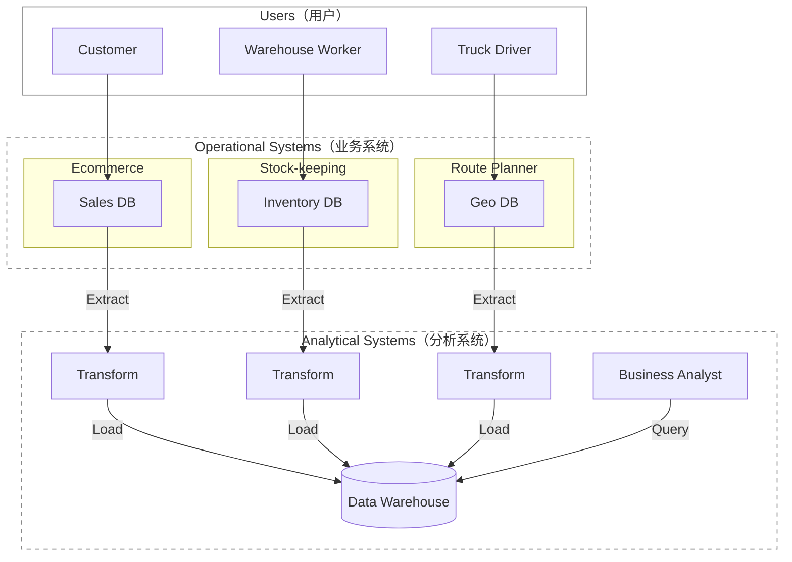

# 《Design Data-Intensive Apps》- 系统设计书学习

> 中文对照版采用 https://ddia.vonng.com/；  [原版](https://www.oreilly.com/library/view/designing-data-intensive-applications/9781098119058/ch01.html)

## 第一章

数据是许多应用开发的核心。少量数据可以在单台机器上存储和处理，随着数据量或查询速率(rate of queries)增长，数据就需要分布到多台机器上。

- 计算密集型（compute-intensive）系统：如何将 某项极其庞大的计算 并行化 (parallel)
- 数据密集型（data-intensive）应用：重点是 数据管理。关心如何 存储和处理 海量数据(large data volumes)、如何管理 数据变更、如何在 故障(failure)和并发(concurrency) 面前保证 一致性(consistency)，以及如何维持 服务(service) 的高可用性 (available)

许多应用都需要组装以下功能：

- 存储数据，以便自己或其他应用日后能够再次找到（*数据库*，*database*）
- 记住开销昂贵的操作结果，加快读取速度（*缓存*，*cache*）
- 允许用户按关键字搜索数据，或以各种方式过滤数据（*搜索索引*，*search index*）
- 在事件和数据变更发生后立即处理（*流处理*，*stream processing*）
- 定期处理累积的大批量数据（*批处理*，*batch processing*

要学习如何决定采用哪些技术，以及如何组合这些技术。

> 前端 frontend：运行在浏览器中的客户端代码
>
> 后端 backend：处理用户请求的服务器端代码
>
> 最大挑战在后端，因为后端要代表 *所有* 用户管理数据。
>
> 后端代码会在一个或多个数据库中读写数据，也与缓存、消息队列等其他数据系统— *数据基础设施*（*data infrastructure*）交互。
>
> 应用代码通常是 *无状态*（*stateless*）的，即处理完一个 HTTP 请求后，它会忘掉有关该请求的一切。
>
> 任何需要在请求之间持久保存的信息，都必须存放在客户端或服务器端的 数据基础设施中。


企业中会与 data 数据 打交道的几类人群：

*后端工程师*（*backend engineer*）：负责构建 处理数据读取和更新请求的服务。这些服务通常直接面向外部用户，或通过其他服务间接为外部用户提供功能。

*业务分析师*（*business analyst*）：根据组织的活动生成报表(reports)，帮助管理层做出更好的决策 — *Business Intelligence*（BI)

*数据科学家*（*data scientist*）：从数据中寻找新的洞见，或利用数据分析和 ML/AI 构建面向用户的产品功能 — 如搜广推系统、风控系统等

对于 *分析（*analytics*）*行为，通常只查看用户和后端服务 产生的数据，不会修改这些数据。因此分为：

- *事务型系统*（*operational system*）：由 产生数据的 backend services & data infrastructure 组成。应用代码根据用户执行的操作，会读取和修改数据库中的数据。
- *分析型系统*（*analytical system*）：保存事务型系统数据的只读副本(read-only copy)，并针对分析行为所需的数据处理方式进行优化。 服务于业务分析师和数据科学家。

> 这两种系统通常彼此分离。 员工通常只会在其中一种系统中工作。

*数据工程师*（*data engineer*）：集成事务型系统和分析型系统，并负责组织的data infra。

*分析工程师*（*analytics engineer*）：对数据进行建模和转换，使其更便于组织内的业务分析师和数据科学家使用。

### 事务型, 分析型

*事务*（*transaction*）：指构成一个逻辑单元的一组读写操作 (reads & writes)

| 特征属性        | 事务型系统（OLTP, <br />online Transaction Processing ） | 分析型系统（OLAP,<br />online Analytical Processing）        |
| --------------- | -------------------------------------------------------- | ------------------------------------------------------------ |
| 主要 read 模式  | Point queries（按 key 读取少量记录）                     | 聚合大量记录 (扫描海量记录，计算<br />计数、总和或平均值等 聚合统计量) |
| 主要 write 模式 | Create, update,  delete 单条记录                         | 批量导入（ETL）或 事件流                                     |
| 人类用户示例    | web/mobile 应用的最终用户                                | 为决策提供支持的内部分析师                                   |
| 机器用途示例    | 检查某项操作是否获得授权                                 | 检测欺诈或滥用模式                                           |
| 查询类型        | Fixed, predefined by application                         | 分析师可以任意查询 (Arbitrary, ad-hoc exploration)           |
| 数据表示的内容  | 数据的最新状态（current point in time）                  | 一段时间内发生的事件历史                                     |
| 数据集规模      | GB 至 TB                                                 | TB 至 PB                                                     |

> OLAP 中的 *联机*（online）含义并不明确；它大概指查询并非只用于预定义报表。

OLTP 系统主要执行 写在应用代码中的一组固定查询，只在维护或排查故障(troubleshooting)时 偶尔运行一次性自定义查询。 （一般不允许 用户自行编写 SQL 查询并提交给数据库执行）。

分析数据库(analytical databases)：常允许 用户自由手写任意 SQL 查询，也可以通过 **Tableau**、Looker 或 Microsoft **Power BI** 等数据可视化或仪表盘工具(dashboard tool) 自动生成查询。

*产品分析*（*product analytics*）或 *实时分析*（*real-time analytics*）：专为分析型负载（即聚合大量记录的查询）而设计，却嵌入在面向用户的产品的系统。包括 Pinot、Druid 和 **ClickHouse**。

> 这类系统 实时 摄取数据，并针对 低延迟查询响应(low-latency query responses) 进行了优化。
>
> 相比之下，传统的 OLAP（联机分析处理）系统常采用 批处理方式(in batches) 摄取数据，更侧重于 高吞吐量(high-throughput) 的查询处理优化。


### 数仓，数据湖

使用专门的一个独立数据库系统（Data Warehouse）运行分析查询，而不是在同一套数据库上同时进行OLTP 与 OLAP。

为什么不宜让 业务分析师和数据科学家 直接查询这些 OLTP 系统：

- 所需数据可能散落在多个事务型系统(OLTP)中，很难通过一条查询组合这些数据集；该问题称为 *数据孤岛*（*data silo*）。
- 适合 OLTP 的模式(schemas) 和 数据布局 不太适合分析(analytics)。
- 分析查询的开销可能很高；在 OLTP 数据库上运行会影响其他用户的性能。
- 出于安全或合规方面的考虑，OLTP 系统可能位于一个不允许用户直接访问的独立网络中。

*数据仓库 （Data Warehouse）*  ：是一个独立的数据库，分析师可以尽情查询，而不会影响 OLTP 系统的运行。

它的存储方式往往与 OLTP 数据库截然不同，以便针对分析中常见的查询类型进行优化。


*Extract–Transform–Load (ETL)*：把数据送入数据仓库的这一过程：数据仓库保存着企业各个 OLTP 系统中数据的只读副本(read-only copy)。数据先从 OLTP 数据库中 extract 出来（通过定期data dump 或 连续的stream of updates），再 transform 成 analysis-friendly schema 并且 进行 clean up，最后 load 进入数据仓库。

有时也会变成 先 load 进入数据仓库，再在数据仓库内 transform；这便成了 *ELT* 。



有时，ETL 流程的数据源是外部 SaaS 产品，例如客户关系管理（CRM）系统；此时只能通过软件供应商的 API 获取数据，然后把这些外部系统的数据导入自己的数据仓库。针对 SaaS API 的 ETL，通常由 Fivetran、Singer 或 AirByte 等专业数据连接器服务实现。

有些数据库系统提供 *hybrid transactional/analytical processing 混合 事务/分析 处理*（HTAP），目标是在单个系统中同时支持 OLTP 和分析，无需通过 ETL 转换。  但许多 HTAP 系统内部仍由一个 OLTP 系统和一个独立的分析系统耦合而成，只是共同隐藏在统一接口。

HTAP 并不能取代数据仓库。它适合的是另一类场景：同一个应用既要运行 扫描大量数据行的分析查询，又要 低延迟地读取和更新单条记录。例如，欺诈检测。

良好实践——事务型系统与分析型系统的分离：每个事务型系统各自拥有数据库，可能产生数百个独立的事务型数据库；企业通常只设一个数据仓库，以便业务分析师在一条查询中组合多个事务型系统的数据。


数据仓库通常采用 *relational* 数据模型，并通过 SQL 查询，很适合业务分析师所需的查询，却不太适合数据科学家的需求：

- 要把数据转换成适合训练 ML model 的形式。通常要把数据库 表中的行列 转换为 vector or matrix of numerical values *(称为 特征 feature）*。
- 对文本数据（例如商品评论）应用 NLP 技术，尝试从中提取结构化信息(structured information)（例如作者表达的情绪）。同样，也可能要用 CV 技术从照片中提取结构化信息。

> *特征工程 feature engineering* ：为了能够最大化 trained model 的性能，来进行以上数据转换的过程。通常需要编写难以用 SQL 表达的自定义代码。

数据科学家不愿在 数据仓库这样的关系数据库 中工作，更喜欢 pandas、scikit-learn 等 Python 数据分析库，R 等统计分析语言，以及 Spark 等分布式分析框架。

组织需要以适合数据科学家使用的形式提供数据 ——  *数据湖*（*data lake*）


 *数据湖*（*data lake*）：一个集中的(centralized) 数据存储库(data repository)，保存一切可能对分析有用的数据副本(copy of any data)，这些数据通过 ETL 流程从事务型系统(operational systems) 取得。

与数据 warehouse的区别：数据 lake 只保存文件，并不强制规定 file format，data model, or schema。

> 数据湖中的文件可以是一批数据库记录，以 Avro 或 Parquet 等文件格式编码；
>
> 也完全可以是文本、图像、视频、稀疏矩阵、特征向量、基因组序列，或任何其他类型的数据。

数据湖不仅更加灵活，而且往往比 relational data storage 更便宜，因为它可以使用 object stores 等廉价通用的文件存储。

*数据管道*（*data pipeline)*： ETL 流程的泛化。

某些情况下，数据湖成为 operational systems 通往data warehouse 途中的一站。数据湖按照“原始(raw)”形态保存 operational systems产生的数据，不把它们转换成关系型数据仓库的模式。好处是：每个数据消费者都可以把原始数据转换成最适合自己需求的形式 —— *寿司原则*（*sushi principle*）：“原始数据更好”


*数据湖仓*（*data lakehouse*）：直接针对数据湖中的文件运行典型的数据仓库 workloads（SQL 查询和业务分析），并与数据科学和机器学习 workloads 并存。它需要在数据湖的文件存储之上增加 query execution engine 和 metadata 层（例如 schema management）。  **Apache Hive**、**Spark SQL**、Presto 和 Trino 都采用了这种方法。


组织也越来越重视分析系统与数据管道的管理和运维，如遵守 GDPR、CCPA 等法规。

有时，分析系统的输出还会提供给事务型系统，这个过程称为 *反向 ETL*（*reverse ETL*）。例如，在分析系统中训练好的 ML model 可以部署到生产环境。可以借助 TFX、Kubeflow 或 MLflow 等工具部署到事务型系统。


*记录系统*（*system of record*）/ *权威数据源*（*source of truth*）：保存某类数据的 权威(authoritative) 或 规范（canonical）版本。新数据被首先写入这里。每项事实只表示一次，通常采用 *规范化*（*normalized*）表示。如果其他系统与记录系统的数据不一致(discrepancy)，那么应以记录系统中的值为准。

*衍生数据系统*（*derived data system*）：衍生系统中的数据，是以另一个系统中的现有数据为基础，经过某种转换或处理而得到的结果。衍生数据即使丢失，也可以从原始数据源重新创建。   比如 缓存cache、在数据集上训练的模型。 

衍生数据是 *冗余*（*redundant*）的，因为它复制了现有信息。但你可以从同一个数据源衍生出多个不同的数据集，从不同“视角”观察数据。

一个系统究竟属于哪一类，取决于它在应用中的用法，而不是采用了什么工具。


### 云服务

软件由谁来构建，又由谁来部署。两项工作都可以按不同程度外包：

```
In-house Software          Off-the-shelf Software         Off-the-shelf Software
In-house Operations        In-house Operations           Outsourced Operations
(e.g. Application Code)    (e.g. Self-hosted DB on IaaS)  (e.g. Cloud Services/SaaS)
←──────────────────────────────────────────────────────────────────────────→

More Control                                                    Less Control
Greater Investment                                            Lower Investment
```

使用云服务(cloud service) ：把软件的运维外包(outsource)给云服务商。

云服务适合：不必专门考虑infra的运维、系统负载随时间大幅波动可以弹性计算资源。

云服务最大的缺点——你无法掌控它：

- 如果服务缺少需要的功能，只能等供应商添加；通常无法自己动手实现。
- 如果服务宕机，只能等它恢复。
- 如果你的某种使用方式触发了缺陷或性能问题，诊断起来会非常困难。
- 如果服务停止运营、价格高到无法接受，或供应商以你不喜欢的方式改动产品，也只能任其摆布——产生了供应商锁定(vendor lock-in) 问题。
- 如果云服务提供商位于其他国家，与你所在国发生政治冲突，可能因遭受制裁而无法继续使用。
- 你必须相信云服务商能够保护数据安全，这可能会增加遵守隐私和安全法规的难度。


Cloud Native 系统架构

*云原生*（*cloud-native*）：专为利用云服务优势而设计的架构。

| 类别        | 自托管(self-hosted) 系统        | 云原生系统                                                 |
| ----------- | ------------------------------- | ---------------------------------------------------------- |
| 事务型/OLTP | **MySQL**、PostgreSQL、MongoDB  | AWS Aurora 、Azure SQL DB Hyperscale、Google Cloud Spanner |
| 分析型/OLAP | Teradata、ClickHouse、**Spark** | **Snowflake**、Google BigQuery、Azure Synapse Analytics    |

在云中，软件可以运行在基础设施即服务（IaaS）环境里，使用一台或多台虚拟机VM（也称 *实例*，*instance*），每台实例分配一定数量的 CPU、内存、磁盘和网络带宽。与物理机器相比，云实例的开通速度更快。

云原生服务的关键思想：不仅使用操作系统管理的计算资源，还要在低层云服务的基础上构建更高层的服务。

- Amazon S3 (Simple Storage Service)、Azure Blob Storage 和 Cloudflare R2 等 *对象存储*（*object storage*）服务用于保存大型文件。它们的 API 比普通文件系统更受限，只提供基本的文件读写；

  但好处是隐藏了底层物理机器，服务会自动把数据分布到许多机器上。

- 许多其他服务又建立在对象存储和其他云服务之上。例如，Snowflake 是一种云端分析数据库（数据仓库），依靠 S3 存储数据；还有一些服务进一步构建在 Snowflake 之上。


**存储与计算 分离**

云中的计算实例（虚拟机）也可以连接本地磁盘，但云原生系统通常更愿意把它们当作临时缓存，而不是长期存储。作为替代，云服务提供虚拟磁盘(virtual disk)存储，可以从一个实例卸载，再挂载到另一个实例上，例如 Amazon EBS、Azure 托管磁盘和 Google Cloud 持久磁盘。

这种虚拟磁盘并不是真正的物理磁盘，而是由另一组机器提供的云服务，用来模拟磁盘( *块设备*（*block device*）)的行为，其中每个块通常为 4 KiB。  但块设备模拟会引入额外开销；且虚拟块设备上的每次 I/O 实际上都是一次网络调用。

因此，云原生服务通常避开虚拟磁盘，转而建立在 针对特定工作负载(workloads)优化 的 专用存储服务(dedicated storage services)上。S3 等对象存储服务适合长期保存较大的文件，大小从数百 KB 到数 GB 不等。数据库中的单行或单个值通常远小于这个范围；

因此，云数据库通常在一个独立服务中管理较小的值，并把包含许多个值的较大数据块(data blocks)存入对象存储。

- 传统系统架构中，同一台计算机同时负责存储（磁盘）和计算（CPU 与内存）
- 云原生系统中，这两项职责在一定程度上相互分离，被 *解耦*（*disaggregated*）。例如，S3 只负责保存文件；如果要分析其中的数据，就必须在 S3 之外运行分析代码 (通过网络传输数据)。

云原生系统采用 *多租户*（*multitenant*）模式：它不为每个客户单独分配一台机器，而是由同一项服务在共享硬件上处理多个客户的数据和计算。


**云时代的运维(Operations)**

*数据库管理员*（DBA）或 *系统管理员*（sys admin）：传统上，管理组织 服务器端 数据基础设施的人员。

*DevOps / SRE (Site reliability engineers)* ：把软件开发与运维角色融入同一个团队，让团队共同负责后端服务和数据基础设施。 

运维的职责：确保服务可靠地交付(reliably delivered)给用户，包括配置基础设施和部署应用；同时保障生产环境稳定(stable production environment)，包括监控和诊断任何可能影响可靠性的问题。

许多云服务通过 API 隐藏了实际承载服务的一台台机器，采用 *按量计费*（*metered billing*），自带高可用性。

- 基础设施公司的运维团队专攻如何面向大量客户提供可靠服务；
- 云服务客户则力求把投入基础设施的时间和精力降到最低

DevOps/SRE 理念更强调：

- 自动化(automation)——采用可重复的流程，而不是手工执行一次性任务(one-off jobs)；
- 采用临时性的(ephemeral) 虚拟机和服务，而不是长时间运行的服务器(long-running servers)；
- 支持频繁更新应用；
- 从事故中吸取教训；
- 即使人员来去更替，也要保留组织对系统的知识

### 分布式系统

*分布式系统*（*distributed system*）：由多台机器通过网络通信(communicating via a network) 而构成的系统。

 *节点*（*node*）：参与分布式系统的每个进程(process)。

为什么要使用：

- 一项应用涉及两个或更多交互的用户，而每个用户都使用自己的设备，那么这个系统不可避免地是分布式的
- 数据存储在一个服务中，却要由另一个服务处理，就必须通过网络把数据传输  （云原生系统、微服务都是分布式的）
- 用多台机器提供冗余(redundancy)，保证容错(Fault tolerance) ，高可用性(high availability)
- Scalability，把负载分散到多台机器上。
- Latency，全球多个区域部署服务器，让每个用户都由地理位置较近的服务器提供服务。
- Elasticity，云端部署可以随着需求扩大或缩小，让你只为正在使用的资源付费。
- 系统的各个部分可以采用与各自工作负载相匹配的硬件。
- 一项服务的用户分布在多个这样的司法管辖区，就不得不把用户数据分散到多个地点的服务器上。
- 选择可再生电力充足的时间和地点，并避开电网负荷紧张的时候。

分布式系统的缺点和注意问题：

- 每一个经过网络的请求和 API 调用，都必须面对失败的可能——网络可能中断，服务可能过载或崩溃，任何请求都有可能超时而收不到响应
- 调用另一个服务仍然远远慢于在同一进程中调用函数
- 处理海量数据时，与其把数据从存储位置传到另一台机器上处理，可能不如把计算带到已经保存数据的机器上来得快
- 节点更多也不一定更快
- 分布式系统往往很难排查故障：如果系统响应缓慢，怎样才能找出问题在哪里？
- 当每个服务都有自己的数据库时，如何保持不同服务之间的数据一致。

*可观测性*（*observability*）：用于诊断(diagnosing) 分布式系统问题的技术。它收集系统的执行数据，并允许人们查询这些数据，从而既能分析高层指标，也能追查单个事件。 **OpenTelemetry**、Zipkin 和 **Jaeger** 等 *追踪*（*tracing*）工具可以记录哪个客户端为了什么操作调用了哪个服务器，以及每次调用花了多长时间。

### **Microservices(微服务) & Serverless(无服务器)**

*面向服务架构*（SOA, service-oriented architecture）：划分为客户端(client) 和服务器(server) ，由客户端向服务器发送请求，使用HTTP来通信；同一个进程既可以是服务器（处理传入的请求），也可以是客户端（向其他服务发出请求）。

演化为 *微服务*（*microservices*）架构：每项服务(service) 都有明确的用途（例如 S3 的用途就是文件存储），服务通过 API 向客户端开放能力，由客户端经网络调用；每项服务由一个团队负责维护。这样复杂应用就可以被拆分(decomposed) 成多项相互交互的服务，分别由不同团队管理。

云原生系统大量采用服务拆分，但本地部署(on-premises) 的系统同样可以采用面向服务的方法。

微服务优点：

- 各项服务可以独立更新，减少团队之间的协调(coordination effort)
- 每项服务可以获得符合自身需要的硬件资源
- 实现细节隐藏在 API 后面，服务负责人可以自由改变实现，而不影响客户端
- 数据存储方面，通常每项服务都有自己的数据库，服务之间不共享数据库

存在的问题：

- 服务多了本身也会滋生复杂度(breed complexity)

- 每项服务都需要相应基础设施，用来部署新版本、根据负载调整硬件资源、收集日志、监控服务健康状况。

  Kubernetes 等 *编排*（*orchestration*）框架为这类基础设施提供了基础能力，因此成了部署服务的常用方式。

- 开发过程中测试一项服务也可能很麻烦，因为它所依赖的其他服务必须一并运行

- 微服务 API 也很难演化；随着业务需求改变，开发者或许想要增删 API 字段，但这可能导致客户端出错。

  OpenAPI 和 gRPC 等 API 描述标准有助于管理客户端 API 与服务器 API 之间的关系。

微服务主要是让不同团队无需彼此协调，也能独立推进工作。对大公司很有价值。


*无服务器*（serverless），又称 *函数即服务*（FaaS, function as a service）：另一种服务部署方式。把基础设施管理进一步外包给云服务商，由云服务商根据发往服务的请求，自动分配和释放硬件资源。 每次执行无服务器函数仍然要用到一台服务器，只是下一次执行可能换到另一台。

云存储用按量计费取代了容量规划（提前决定购买多少磁盘），无服务器模式也把按量计费带到了代码执行：你只需为应用代码实际运行的时间付费，不必提前配置资源。

### **云计算 & 超算**

构建大规模(large-scale) 计算系统除了*云计算 (cloud computing)*，另一条路线是 *高性能计算*（HPC, high-performance computing），也称为 *超级计算*（*supercomputing*）。

- 超级计算机通常用于计算密集型的科学计算任务，例如天气预报、气候建模、分子动力学（模拟原子和分子的运动）、复杂优化问题，以及求解偏微分方程。

  云计算则更常用于在线服务、业务数据系统，以及其他需要以高可用性响应用户请求的系统。

- 超级计算机通常运行大型批处理作业(large batch jobs)，并不时把计算状态作为检查点写入磁盘。如果某个节点发生故障，一种常见做法是直接停止整个集群的工作负载，修复故障节点，再从最近的检查点重新开始计算。

  云服务通常不宜这样停掉整个集群，因为服务必须持续响应用户，尽量减少中断。

- 超级计算机的节点通常通过共享内存(shared memory) 和 远程直接内存访问（RDMA）通信，既有高带宽(high bandwidth)，又有低延迟，但前提是系统用户彼此高度信任。

  在云计算中，网络和机器常由互不信任的组织共享，因此需要更强的安全机制，例如资源隔离(resource isolation)（使用虚拟机等）、加密(encryption) 和认证(authentication)。

- 云数据中心网络通常以 IP 和以太网为基础，采用 Clos 拓扑来提供较高的对分带宽——这是衡量网络整体性能的常用指标。

  超级计算机则常采用专门的网络拓扑，例如多维网格和环面；对于通信模式已知的 HPC 工作负载，这类拓扑可以提供更好的性能。

- 云计算允许节点分布在多个地理区域；

  超级计算机通常假定所有节点都彼此邻近。


## 第二章

