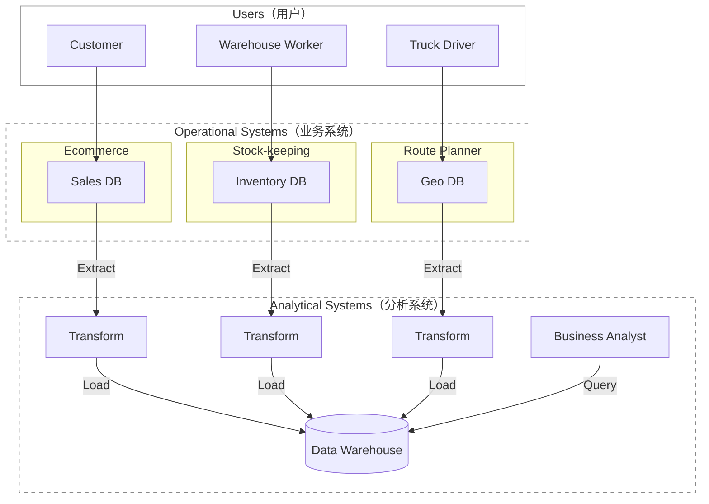

# 《Design Data-Intensive Apps》- 系统设计书学习

> 中文对照版采用 https://ddia.vonng.com/

# 第一章

数据是许多应用开发的核心。少量数据可以在单台机器上存储和处理，随着数据量或查询速率(rate of queries)增长，数据就需要分布到多台机器上。

- 计算密集型（compute-intensive）系统：如何将 某项极其庞大的计算 并行化 (parallel)
- 数据密集型（data-intensive）应用：重点是 数据管理。关心如何 存储和处理 海量数据(large data volumes)、如何管理 数据变更、如何在 故障(failure)和并发(concurrency) 面前保证 一致性(consistency)，以及如何维持 服务(service) 的高可用性 (available)

许多应用都需要组装以下功能：

- 存储数据，以便自己或其他应用日后能够再次找到（*数据库*，*database*）
- 记住开销昂贵的操作结果，加快读取速度（*缓存*，*cache*）
- 允许用户按关键字搜索数据，或以各种方式过滤数据（*搜索索引*，*search index*）
- 在事件和数据变更发生后立即处理（*流处理*，*stream processing*）
- 定期处理累积的大批量数据（*批处理*，*batch processing*

要学习如何决定采用哪些技术，以及如何组合这些技术。

> 前端 frontend：运行在浏览器中的客户端代码
>
> 后端 backend：处理用户请求的服务器端代码
>
> 最大挑战在后端，因为后端要代表 *所有* 用户管理数据。
>
> 后端代码会在一个或多个数据库中读写数据，也与缓存、消息队列等其他数据系统— *数据基础设施*（*data infrastructure*）交互。
>
> 应用代码通常是 *无状态*（*stateless*）的，即处理完一个 HTTP 请求后，它会忘掉有关该请求的一切。
>
> 任何需要在请求之间持久保存的信息，都必须存放在客户端或服务器端的 数据基础设施中。

企业中会与 data 数据 打交道的几类人群：

*后端工程师*（*backend engineer*）：负责构建 处理数据读取和更新请求的服务。这些服务通常直接面向外部用户，或通过其他服务间接为外部用户提供功能。

*业务分析师*（*business analyst*）：根据组织的活动生成报表(reports)，帮助管理层做出更好的决策 — *Business Intelligence*（BI)

*数据科学家*（*data scientist*）：从数据中寻找新的洞见，或利用数据分析和 ML/AI 构建面向用户的产品功能 — 如搜广推系统、风控系统等

对于 *分析（*analytics*）*行为，通常只查看用户和后端服务 产生的数据，不会修改这些数据。因此分为：

- *事务型系统*（*operational system*）：由 产生数据的 backend services & data infrastructure 组成。应用代码根据用户执行的操作，会读取和修改数据库中的数据。
- *分析型系统*（*analytical system*）：保存事务型系统数据的只读副本(read-only copy)，并针对分析行为所需的数据处理方式进行优化。 服务于业务分析师和数据科学家。

> 这两种系统通常彼此分离。 员工通常只会在其中一种系统中工作。

*数据工程师*（*data engineer*）：集成事务型系统和分析型系统，并负责组织的data infra。

*分析工程师*（*analytics engineer*）：对数据进行建模和转换，使其更便于组织内的业务分析师和数据科学家使用。

*事务*（*transaction*）：指构成一个逻辑单元的一组读写操作 (reads & writes)

| 特征属性        | 事务型系统（OLTP,  online Transaction Processing ） | 分析型系统（OLAP, online Analytical Processing）        |
| --------------- | -------------------------------------------------------- | ------------------------------------------------------------ |
| 主要 read 模式  | Point queries（按 key 读取少量记录）                     | 聚合大量记录 (扫描海量记录，计算 计数、总和或平均值等 聚合统计量) |
| 主要 write 模式 | Create, update,  delete 单条记录                         | 批量导入（ETL）或 事件流                                     |
| 人类用户示例    | web/mobile 应用的最终用户                                | 为决策提供支持的内部分析师                                   |
| 机器用途示例    | 检查某项操作是否获得授权                                 | 检测欺诈或滥用模式                                           |
| 查询类型        | Fixed, predefined by application                         | 分析师可以任意查询 (Arbitrary, ad-hoc exploration)           |
| 数据表示的内容  | 数据的最新状态（current point in time）                  | 一段时间内发生的事件历史                                     |
| 数据集规模      | GB 至 TB                                                 | TB 至 PB                                                     |

> OLAP 中的 *联机*（online）含义并不明确；它大概指查询并非只用于预定义报表。

OLTP 系统主要执行 写在应用代码中的一组固定查询，只在维护或排查故障(troubleshooting)时 偶尔运行一次性自定义查询。 （一般不允许 用户自行编写 SQL 查询并提交给数据库执行）。

分析数据库(analytical databases)：常允许 用户自由手写任意 SQL 查询，也可以通过 **Tableau**、Looker 或 Microsoft **Power BI** 等数据可视化或仪表盘工具(dashboard tool) 自动生成查询。

*产品分析*（*product analytics*）或 *实时分析*（*real-time analytics*）：专为分析型负载（即聚合大量记录的查询）而设计，却嵌入在面向用户的产品的系统。包括 Pinot、Druid 和 **ClickHouse**。

> 这类系统 实时 摄取数据，并针对 低延迟查询响应(low-latency query responses) 进行了优化。
>
> 相比之下，传统的 OLAP（联机分析处理）系统常采用 批处理方式(in batches) 摄取数据，更侧重于 高吞吐量(high-throughput) 的查询处理优化。

## 数仓，数据湖

使用专门的一个独立数据库系统（Data Warehouse）运行分析查询，而不是在同一套数据库上同时进行OLTP 与 OLAP。

为什么不宜让 业务分析师和数据科学家 直接查询这些 OLTP 系统：

- 所需数据可能散落在多个事务型系统(OLTP)中，很难通过一条查询组合这些数据集；该问题称为 *数据孤岛*（*data silo*）。
- 适合 OLTP 的模式(schemas) 和 数据布局 不太适合分析(analytics)。
- 分析查询的开销可能很高；在 OLTP 数据库上运行会影响其他用户的性能。
- 出于安全或合规方面的考虑，OLTP 系统可能位于一个不允许用户直接访问的独立网络中。

*数据仓库 （Data Warehouse）*  ：是一个独立的数据库，分析师可以尽情查询，而不会影响 OLTP 系统的运行。

它的存储方式往往与 OLTP 数据库截然不同，以便针对分析中常见的查询类型进行优化。

*Extract–Transform–Load (ETL)*：把数据送入数据仓库的这一过程：数据仓库保存着企业各个 OLTP 系统中数据的只读副本(read-only copy)。数据先从 OLTP 数据库中 extract 出来（通过定期data dump 或 连续的stream of updates），再 transform 成 analysis-friendly schema 并且 进行 clean up，最后 load 进入数据仓库。

有时也会变成 先 load 进入数据仓库，再在数据仓库内 transform；这便成了 *ELT* 。

有时，ETL 流程的数据源是外部 SaaS 产品，例如客户关系管理（CRM）系统；此时只能通过软件供应商的 API 获取数据，然后把这些外部系统的数据导入自己的数据仓库。针对 SaaS API 的 ETL，通常由 Fivetran、Singer 或 AirByte 等专业数据连接器服务实现。

有些数据库系统提供 *hybrid transactional/analytical processing 混合 事务/分析 处理*（HTAP），目标是在单个系统中同时支持 OLTP 和分析，无需通过 ETL 转换。  但许多 HTAP 系统内部仍由一个 OLTP 系统和一个独立的分析系统耦合而成，只是共同隐藏在统一接口。

HTAP 并不能取代数据仓库。它适合的是另一类场景：同一个应用既要运行 扫描大量数据行的分析查询，又要 低延迟地读取和更新单条记录。例如，欺诈检测。

良好实践——事务型系统与分析型系统的分离：每个事务型系统各自拥有数据库，可能产生数百个独立的事务型数据库；企业通常只设一个数据仓库，以便业务分析师在一条查询中组合多个事务型系统的数据。

数据仓库通常采用 *relational* 数据模型，并通过 SQL 查询，很适合业务分析师所需的查询，却不太适合数据科学家的需求：

- 要把数据转换成适合训练 ML model 的形式。通常要把数据库 表中的行列 转换为 vector or matrix of numerical values *(称为 特征 feature）*。
- 对文本数据（例如商品评论）应用 NLP 技术，尝试从中提取结构化信息(structured information)（例如作者表达的情绪）。同样，也可能要用 CV 技术从照片中提取结构化信息。

> *特征工程 feature engineering* ：为了能够最大化 trained model 的性能，来进行以上数据转换的过程。通常需要编写难以用 SQL 表达的自定义代码。

数据科学家不愿在 数据仓库这样的关系数据库 中工作，更喜欢 pandas、scikit-learn 等 Python 数据分析库，R 等统计分析语言，以及 Spark 等分布式分析框架。

组织需要以适合数据科学家使用的形式提供数据 ——  *数据湖*（*data lake*）

 *数据湖*（*data lake*）：一个集中的(centralized) 数据存储库(data repository)，保存一切可能对分析有用的数据副本(copy of any data)，这些数据通过 ETL 流程从事务型系统(operational systems) 取得。

与数据 warehouse的区别：数据 lake 只保存文件，并不强制规定 file format，data model, or schema。

> 数据湖中的文件可以是一批数据库记录，以 Avro 或 Parquet 等文件格式编码；
>
> 也完全可以是文本、图像、视频、稀疏矩阵、特征向量、基因组序列，或任何其他类型的数据。

数据湖不仅更加灵活，而且往往比 relational data storage 更便宜，因为它可以使用 object stores 等廉价通用的文件存储。

*数据管道*（*data pipeline)*： ETL 流程的泛化。

某些情况下，数据湖成为 operational systems 通往data warehouse 途中的一站。数据湖按照“原始(raw)”形态保存 operational systems产生的数据，不把它们转换成关系型数据仓库的模式。好处是：每个数据消费者都可以把原始数据转换成最适合自己需求的形式 —— *寿司原则*（*sushi principle*）：“原始数据更好”

*数据湖仓*（*data lakehouse*）：直接针对数据湖中的文件运行典型的数据仓库 workloads（SQL 查询和业务分析），并与数据科学和机器学习 workloads 并存。它需要在数据湖的文件存储之上增加 query execution engine 和 metadata 层（例如 schema management）。  **Apache Hive**、**Spark SQL**、Presto 和 Trino 都采用了这种方法。

组织也越来越重视分析系统与数据管道的管理和运维，如遵守 GDPR、CCPA 等法规。

有时，分析系统的输出还会提供给事务型系统，这个过程称为 *反向 ETL*（*reverse ETL*）。例如，在分析系统中训练好的 ML model 可以部署到生产环境。可以借助 TFX、Kubeflow 或 MLflow 等工具部署到事务型系统。
