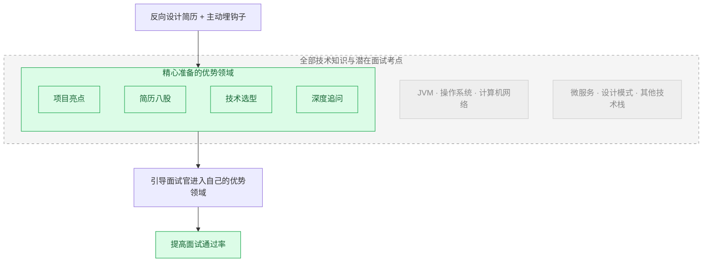

# 面试话术&准备

## STAR 法则

Situation(情境) — Task(任务) — Action(行动)— Result(结果)

无效回答, 问题都出在A太短, R太虚.

| 环节       | 回答的问题      | 篇幅占比 | 常见写法                                                     |
| ---------- | --------------- | -------- | ------------------------------------------------------------ |
| S 情境     | 当时是什么局面? | 15%      | 一句话给背景+难度:"Q3转化率连续两月下滑12%, 团队只有3人"     |
| T任务      | 你要达成什么?   | 10%      | 目标+约束:"我负责4周内把转化率拉回基线, 且不能加预算"        |
| **A 行动** | 你做了什么?     | 50%      | 分步骤, 带方法, 带取舍:"先拆漏斗定位到支付页流失, 做了A/B测试..." |
| R 结果     | 带来了什么改变? | 25%      | 量化+复盘:"转化率+8%, 超基线4个百分点; 沉淀成标准流程"       |

Example：

- 我设计了一套活动状态机模型, 用来统一管理游戏内所有活动的生命周期。
- 在没有这套机制之前, 我们有一些问题：
  - 第一点：每个活动都要自己维护状态流转. 比如开发一个新活动, 每个开发者都需要自己写代码判断: 活动 是否到了开启或者关闭时间, 玩家等级是否达到了要求? 
  - 接着是第二点, 活动的状态不统一, 比如有些开发者用字符串,"open","close"标识状态,有些用数字1, 2, 3标 识, 这导致代码可读性较差, CR困难. 
  - 最后是生命周期管理混乱, 每个开发者要自己判断活动的当前状态以及之后的状态, 从而调用一些活动开启, 关闭 或者跨天时的方法. 
- 为了解决这些问题：我首先是统一了状态定义, 一个活动有三个状态: 关闭, 开启, 提前收集. 接着通过一个统一 的活动状态机模型管理状态转化, 而不是将状态的流转分散到各个活动本身的代码中. 最后我还定义了一些生命周 期的hook, 比如OnOpen, OnClose, 提供给状态流转之后进行自动调用, 让开发者只需要关注业务逻辑的实 现, 而不用关心状态本身的流转. 这里面主要用了一些设计模式, 比如策略模式, 不同活动可以自定义状态判断策略, 还有模板方法模式: 定义了活 动处理的标准流程. 
- 这样优化过后, 可以提升业务开发者的开发效率, 降低新活动的开发时间大约1pd, 让开发者只需要关注业务逻 辑, 不需要关心状态的流转, CR也更方便了.

## 遇到什么困难，考虑了什么方案，最后选择了什么，为什么这么选

Example：

- 一个排行榜定时结算的业务 每个区有个排行榜 定时12点结算排行榜

  因为无状态服务他不知道负责哪个大区，要维护额外数据，比如可能需要去查询外部数据，拿到一个大区id，然后判断这个区有没有结算过等操作 太麻烦 

  也可以去搞个分布式任务调度组件比如 xxl-job做定时任务 但是增加了技术债以及成本

  最后我们有个大区服务zonesvr，这个zonesvr是配置固定了负责哪个大区，并且本身也是有状态服务 他会维护大区数据 并且本身也有做tick 所以很适合做这个业务的信号发生源，还要考虑大区实例迁移的问题，所以要维护一个上次执行成功的时间点的数据在大区数据中，每次tick时候检查，如果因为大区迁移，跳过了这个定时任务的触发时间点，就补偿。

## 实习收获

- 实习中 提升的 是 设计能力，积累设计经验：如何设计数据库表、如何设计索引


## 面试准备方法论

> 传统Java后端路线：（此外就是 leetcode + 项目）
>
> Java + MySQL + JavaWeb + SSM(Spring, SpringMVC, Mybatis) + SpringBoot  [外卖项目]
>
> Redis + RocketMQ + JVM + JUC   [点评项目]
>
> SpringCloud 微服务、Linux、AI Agent相关
>
> 操作系统 + 计算机网络 + 设计模式 + （Dubbo 、Netty 、Zookeeper）

面试官通常会根据**我们的简历**以及**岗位需要的内容**去进行进行提问.

> 简历能够通过筛选， 其实就说明简历包含在岗位需要的内容里了

针对性的直接学习面试官想问的东西，诱导性的牵引面试官对我们掌握内容进行提问。

 一方面涉及简历的撰写, 一方面涉及针对历可能被提问内容的话术引导：

1. 基于你想让面试官所提问的去撰写简历 

2. 回答出你想让面试官提问的问题 ：

   反向思考，面试官绝大多数情况都会**根据我们的简历进行提问**, 而我们撰写的简历又**不能深度太浅否则无法到达面试**这一步。我们需要在这两者间不断的调整简历撰写, 并不断的推问自己是面试官, 看到简历这段话会问些什么, 去努力达到一种平衡。

   > 写的内容也都得是自己会的内容。

3. 通过面试拿到offer

```
研究岗位 JD
准备项目、反向设计简历
AI 深挖简历、准备题库
背八股、练话术、埋钩子
海投、真实面试
复盘、查漏补缺
不断循环，直到拿到 Offer
```

- **以简历划定学习范围，以 AI 预测考点，以真实面试修正学习方向。**

  > **传统思路：** 学完 Redis，看看面试能不能用上。
  >
  > **新思路：** 预测面试会问 Redis 的哪些知识，然后针对性地学习。

```
简历上的一句项目描述
AI 预测 20 道面试题
针对性学习、模拟追问
真实面试，主动埋钩子
收集新问题，完善题库
循环迭代，直到拿到 Offer
```

Example：

> 很多岗位都需要掌握 mq 相关内容, 所以在自己 vibe 的项目里去问 AI, 如何缝合mq相关的内容去撰写到我自己的简历上? 
>
> - 引入RocketMQ构建事件驱动型分布式异步架构, 
> - 对视频上传全链路进行 [ 流量解耦与任务下沉 ] , 剥离重IO, 长周期计算任务, 核心接口端到端时延从60s+优化至10ms以内, 
> - 完成同步阻塞架构向 [ 高吞吐异步分布式架构 ] 的演进.

> 流量解耦与任务下沉?高吞吐异步分布式架构? 我绝对把握不住, 这种莫名其妙的词在面试上只会害死我. 
>
> 但是 [ 减少响应时间 ] 听起来不错? 我会继续问ai, 去把这个思想简化成实习生容易把握住的内容.

>  [ **引入RocketMQ将视频处理相关长耗时任务全链路异步化**, 将60s+上传接口**响应时间压缩至50ms以内.** ] 听起来似乎不错. 
>
> 然后我会去问RocketMQ是什么? 异步化是什么? 
>
> 再进一步, 如果我是面试官, 我看到这一段, 我会有哪些值得追问的问题? 
>
> 然后我理解一些基本信息后, 知道了面试官可能会问: **为什么会用MQ**？**为什么会选择RocketMQ**？你是**怎么具体实现**的? **数据如何测**得?    
>
> 然后就是发MQ失败以及消息堆积, 重复消费, 顺序消费, 如何保障消息不丢失这种**众所周知的八股**了。
>
> 八股是如何产生的? 就是前辈被面试官 一遍遍的拷打后留下的宝贵财富。

```
你是一名大厂Java后端开发面试官。请针对以下简历项目描述进行深度追问。
1. 拆解每一句话中的技术关键词。
2. 列出可能出现的面试问题。
3. 按照考察频率和重要性排序。
4. 从基础概念、技术选型、业务场景、实现原理、异常处理等角度逐层追问。
5. 指出简历中过度包装或容易被质疑的地方。
6. 给出适合实习生理解和掌握的回答。
以下是我的项目描述：
```

但是存在一个显著问题：基础薄弱的我对MQ理解仅仅停留在浅层, 仅仅依赖 AI, 短期时间能否掌握面试官可能问的全部问题?    - 不够, AI 能够列出8成左右的面试官会深追的问题, 但还是有缺陷, 这些问题也还是太多了.

（实际过程中 不怎么细问 [ 怎么具体实现 ] ，反而是 [ 为什么选择 XXX]， 因为这需要了解自己项目的优缺点和特点）

如何知道哪些是关键问题，就靠不停面试。面试本身非常重要, 是后续调整方向的关键因素, 不要惧怕面试, 面试不是任何期末而是一次随堂小测

只要面试的够多, 哪怕你之前完全不懂简历的东西, 也会在一次次面试中掌握面试的精髓, 知道如何去把面试节 奏掌握在自己手里. 

反面案例：就是一直准备准备却不敢约面试, 本质是对自己的不自信和对面试的高看, 这不仅会导致晚投浪费机会, 同时可能一直准备的是毫不高频没人问的领域而不自知。

早面试有太多数不清的好处, 胜利本就属于勇敢的人. 希望大家能正确认识面试, 面试本质就是一场草台班子选 一个新草堆, 不严肃不恐怖。

缺点当然也有, 可能有些对某些公司情怀的人会纠结早面会浪费机会, 其实先投小厂再投不想去的厂, 最后投你想去的厂就可以了.


如何在面试中掌握节奏并去从容的引领面试：

Example：

> xxx 是我借助AIcoding辅助开发的全栈项目. 具体为xxxx, 项目做好基础功能之后, 我发现核心的问题压根不在AI调用本身, 而在于视频处理是一个典型的长耗时, 高资源 消耗场景, 
>
> 围绕这个背景产生的痛点, 我去实际解决这些实际问题. 比如
>
> 1.比如在上传课程平台的课程视频时, 由于校园网不稳定经常下载中断导致前功尽弃, 我引入了分片上传断点续 传.
>
> 2.比如用户端重复点击导致同一个视频多次API调用, 生几乎一致的结果但是消耗成倍的Token, 为了防止重复消 费去引入了Redission分布式锁 ( 诡异处理选型, 埋钩子, 引出自己的选型思考)

埋钩子 让面试官对你精心准备的领域感兴趣, 去dfs问你擅长的问题了法避开你不擅长的问题. 一个面试短短几十分钟, 埋钩子哪怕两次, 让面试官在你精心准备的话术下开始吟唱起来, 这场面试 就已经成了一大半了.

可参考 [DOvideo](https://github.com/Xiaoc7r/DOVideo-AI)


## 面试准备实践

**自顶向下，抓主要矛盾，舍弃低性价比的学习内容**

> 1. 通过小厂、中厂日常实习，为暑期实习做跳板。
> 2. **冲刺暑期实习**  尽可能进入转正机会多、认可度高的公司。
> 3. **秋招**  8—12月，主要就业战场，尽早投递。
> 4. **春招**  2月底—6月，作为最后的补充机会

- AI基建, 算法, 搜广推 
- 后端, AI应用开发, Agent 
- 数据开发, 安全 
- 前端, 运维, 测开, 测试

**(实习经历) + 项目 + 八股 + 力扣算法**

**尽可能让面试官在整场面试中，沉浸在自己仅仅擅长的一小部分领域。**

优化简历，找别人好的项目，自己把项目吃透。每天就是背八股、刷算法、吃透简历。

leetcode hot100刷了2遍，八股背了3遍。

**为了面试考察到内容去准备**，是性价比最高。

> 学历 >>> 实习 > 项目 = 竞赛。  

### 准备项目

面试官通过项目考察的并不只是你使用了什么技术，而是：

- 你是否能够发现问题？
- 你是否理解业务需求？
- 你为什么选择这种解决方案？
- 你是否具备独立思考和解决问题的能力？

 **项目重点在于解决问题的思考，而不是堆砌技术。**

| 项目类型                             | 推荐程度 | 原因                       |
| ------------------------------------ | -------- | -------------------------- |
| 成熟且不烂大街、有详细文档的商业项目 | 高       | 准备成本低，方便针对性学习 |
| 后端结合 AI Agent 的项目             | 高       | 符合其判断的技术趋势       |
| 自己使用 AI 开发原创项目             | 一般     | 有差异化，但耗费时间       |
| GitHub 开源项目                      | 较低     | 缺乏详细解析时，理解成本高 |
| 点评等常见培训项目                   | 较低     | 同质化严重，难以吸引面试官 |

项目准备的万能公式：**先确定简历内容**，再逐字逐句反向推导面试问题。

例如简历中有一句：

- 使用 RocketMQ 实现业务流程异步化，降低接口响应时间。

围绕这句话，从以下八个维度准备：

维度	        需要回答的问题

基础概念	RocketMQ 是什么？
业务背景	为什么这个业务需要异步化？
技术选型	为什么选择 MQ，而不是线程池？
同类对比	为什么选择 RocketMQ，而不是 Kafka？
实现流程	消息如何发送、存储和消费？
异常兜底	消息丢失、堆积、发送失败怎么办？
实际成果	最终解决了什么问题？
数据验证	性能提升的数据是如何测得的？

```
简历上的一句话
AI 预测面试官的第一层问题
根据答案继续预测第二层追问
继续深挖第三层、第四层问题
彻底理解这句话背后的知识体系
```

### 八股准备

**不要追求全面，追求高频和深度** ：不推荐直接背诵百科全书式的八股资料。

八股的学习优先级应该是：

1. **简历**专业技能中**明确写出的八股**。
2. **项目技术点**能够**延伸出来的八股**。
3. 真实**面试中反复遇到的八股**。
4. 其他通用高频八股。

可以主动将自己擅长的八股写在简历的专业技能栏中。

例如，与其笼统地写“熟悉 Redis”，不如在掌握的前提下写：

> 熟悉 Redis 缓存穿透、缓存击穿、缓存雪崩及其解决方案，了解分布式锁机制。

这样就给面试官提供了明确的提问方向。

**八股不能只回答标准答案**。 **八股重点在于回答的深度，而不是背诵的数量。**

> 例如：**如何回答缓存击穿？**
>
> - 一般回答：缓存击穿是指热点 Key 过期后，大量请求直接访问数据库，导致数据库压力过大。可以通过互斥锁解决。
>
> - 优秀回答：缓存击穿是热点 Key 失效后，大量并发请求直接访问数据库的问题。
>
>   **常见解决方案**有互斥锁和逻辑过期。
>
>   互斥锁可以让一个线程重建缓存，但其他线程可能需要等待。
>
>   逻辑过期可以让请求继续读取旧数据，由后台线程异步重建缓存，但会牺牲一定的数据实时性。
>
>   **在我的项目中**，由于业务读多写少，对数据实时性要求不高，因此**选择逻辑过期方案**，以降低请求阻塞并提高服务可用性。

**万能八股回答模板**

1. 定义 这个问题是什么? 
2. 原因 **为什么会出现**这个问题? 
3. 方案 有哪些**解决方式**? 
4. 对比 不同**方案的优缺点**是什么? 
5. 选型 **为什么我的项目选择**这个方案? 
6. 埋钩子 自然引出其他自己擅长的知识点.

不要让面试官问一句，你才回答一句。

主动回答后续可能出现的问题，展示自己对技术的理解深度，并引导面试官继续考察自己的优势领域。


### 算法准备

最难速成的部分，因此应该尽早开始，每天坚持练习。

优先掌握 LeetCode Hot 100 和其他高频简单题。

- 筛选 Hot 100 高频题目
- 直接阅读标准题解
- 理解解题思路
- 反复默写代码，形成肌肉记忆
- 记录容易写错的地方，反复练习

核心不是独立研究每一道题，而是短时间内能够**识别题型、讲清思路并正确写出**代码。

如果写不出算法：

- 边写边向面试官解释自己的思路，认真听面试官的提示，尽可能完成能够实现的部分。即使最终没有跑通，也要展示自己对问题的理解。
- 不要一直沉默，可以主动请求提示，或者尝试询问是否能够换一道题。


三个环节相互配合：

| 环节       | 目的                         |
| ---------- | ---------------------------- |
| 简历       | 决定面试官可能问什么         |
| 项目和八股 | 保证自己能够深入回答         |
| 面试话术   | 引导面试官继续询问擅长的内容 |

再通过真实面试不断调整自己的知识储备。




****

主流的外卖和点评项目 含金量就挺高的，但有点烂大街。目前来说的话有ai，和ai聊去找想法，项目含金量都是可以做出来的：比如 加入redis分布式锁、多agent、harness enginering。

所有的**技术难点看你侧重于什么**，然后和ai沟通，自己vibe一个项目出来，项目结束后再不断跟ai沟通，让他给你讲明白。也可以自己github上找不错的，再魔改。

你也可以自己一直想做的应用和ai沟通，遇到好的技术点再和ai沟通尝试加进去。

项目是可以包装的，即使你做出来的是一堆屎山，但你**只需要在简历上展现你的技术难点**，聊这些。 最后我觉得项目其实也没有那么的重要，**有实习的时候一般会跟你聊实习**，**有实习尽量让实习包装的很有含金量**，能够就**聊这个都聊不完**。项目更像是缓存，帮助你面试的时候多多命中面试官的兴趣。多一些能聊的东西，真正做什么项目不重要，**重要的是技术难点和业务场景**。


不要把技术栈的学习时间堆长，更不要看视频学，纯浪费时间。

看教程，视频废话占一半，切视频时间占1/4。1个小时有效时间估计就20分钟，而且教的内容都是八股里面的。毫无含金量，事实是还不如自己Vibe。

自顶向下学习：对于一个项目，**先学架构**，初步了解这个项目是如何运转的，然后**开始学习模块**，知道**每个业务是如何实现**的，最后**学事件逻辑**，对于每个事件我们具体如何让他落地，然后把这些内容整理起来，就是一份极其好的开发文档。

> 找学习的项目，第一就是注意需求，某个项目解决了你认为市面上没有的解决的需求，第二就是留意技术栈。第三，Dev是一条经验大于理论的路，多积累经验比理论重要，项目没有适不适合，兜兜转转终究会由浅入深

自己 Vibe Coding 的项目肯定能拿来找工作呀。你写一个项目，最重要的是你了不**了解它是怎么实现**的，解决了什么**实际的市场需求**。这两个是问的最多的。至于你是怎么写出来的，你用什么工具写的，花了多久写的，是抄的别人的还是自己原创的，没有人在意这些问题。只要你能在面试官那里把这个项目回答得非常清晰，符合了他的要求，让他认为是你自己完全原创的，或者是让他认为你对这个项目非常的了解，确实是自己做的，就够了。

直接找一个全栈的业务项目，在git HUB上面问copilot，或者把red me和技术文档扔给聊天ai拆解，也可以直接在VS code或者codex里面让agent直接读项目然后教你怎么做。


| 传统学习思维         | 速成思维                 |
| -------------------- | ------------------------ |
| 学完技术再写简历     | 根据简历决定学什么       |
| 做完项目再准备面试   | 根据面试考点准备项目     |
| 全面学习八股         | 定向深挖八股             |
| 独立研究算法题       | 理解题解，反复默写高频题 |
| 准备充分再投递       | 边投递、边面试、边学习   |
| 面试官问什么就答什么 | 主动引导面试方向         |
| 追求知识全面         | 优先追求面试通过率       |

**速成实习 To-do List**

- **确定方向**：分析目标岗位 JD，提取高频技术栈。
- **准备项目**：选择有详细文档、有技术亮点的项目。
- **反向设计简历**：确保每一句描述都能应对追问。
- **AI 深挖简历**：逐句生成面试题，多层递归追问。
- **项目深挖**：业务背景、技术选型、实现原理、异常兜底。
- **定向准备八股**：优先掌握简历相关及高频考点。
- **练习回答**：定义 → 原因 → 方案 → 对比 → 选型。
- **每日刷算法**：Hot 100，理解题解、默写、复习错题。
- **设计面试话术**：自我介绍、项目介绍、主动埋钩子。
- **尽早海投**：小厂练手，中厂检验，大厂冲刺。
- **面试复盘**：记录问题、查漏补缺、优化简历与话术。
- **循环迭代**：持续投递、面试、复盘，直到拿到 Offer。
