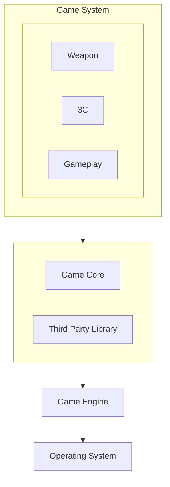
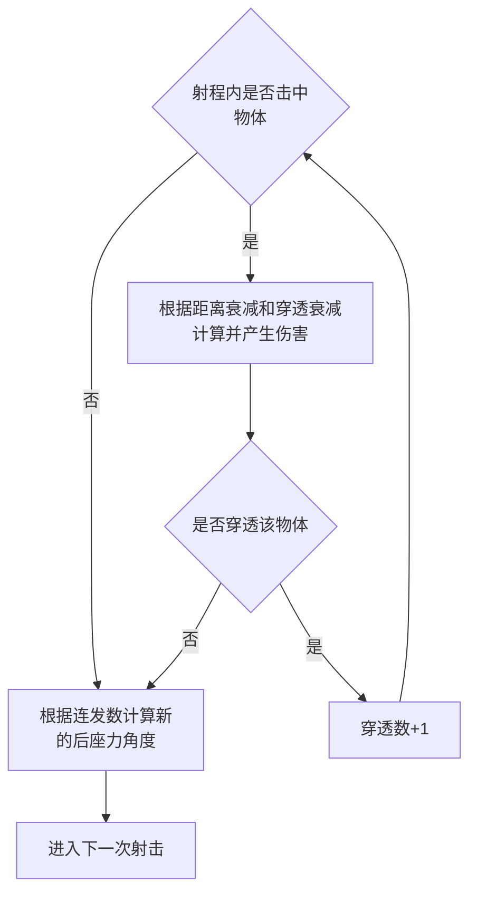

# 游戏客户端入门

> 基于ue5官方的First Person模板，实现一个游戏demo。
>
> 1. 实现会移动和攻击玩家的敌人功能，玩家可以击败敌人；
> 2. 实现基础的得分和游戏胜利机制，具体玩法可以自由发挥；
> 3. 实现多人网络对战；
>
> 如有余力，可自行学习游戏开发其他内容继续添加功能，如渲染、游戏AI等。

## FPS 游戏

FPS: First-person shooter

玩家的视野与角色视野相同，角色的两只手及所操作的枪械。

精准操作与射击反馈：玩家与角色视角重合，武器所带来的后坐力和操作反馈影响视角的变化

战术与信息差：视野的限制，玩家无法拉动相机直接观察周围，只能通过转向,探头等 主动寻找目标信息

FPS必备元素：

- 武器系统
- 角色：1P，3P
- 玩法：PVP，团队竞技，PVE

FPS框架：

- gameplay层
- 游戏系统层
- 游戏层
- 游戏引擎层
- 操作系统层

Weapon system：

- 按种类分: 步枪、狙击枪、手枪、手雷等 
- 按装备位分 主武器、副武器、近战武器、投掷武器
- 按程序逻辑分： InstantHit（即时命中检测）、Projectile（具有抛物线运动轨迹）等

常见物理引擎：

- PhysX
- Havok
- bullet
- UE5自带

物理引擎的使用：

- 角色和场景做静态碰撞检测
- 武器开火命中检测
- 衣服裙摆、死亡的布娃娃系统

枪械弹道：T 字形，逐渐上抬然后左右横扫

- 主视角角度 
- 后坐力  （影响弹道最大）
- 连发数 
- 精准度 
- 散发度

主弹道子弹射出方向 = 主视角角度+后坐力+精准度+散发度

InstantHit Weapon开火流程：武器调用武器对应的开火组件，执行开火逻辑，根据上述弹道计算当前开火朝向，以相机为起点，进行射线检测是否命中物体；若命中，则判断该物体的layer是否为静态场景。若可穿透则以当前命中点为起点，再次做射线检测，直至最大的穿透值结束。

3C system：

> 最早由Ubisoft提出

- Character:角色,具有一定的能力或行为,玩家可以进行扮演或观察 
- Camera:相机,玩家通过它观察游戏世界,获得体验感和沉浸感 
- Control:控制,为玩家提供不同方式、不同体验的交互

好的3C系统就是 对 控制硬件输入响应零延迟感，对角色操作灵活，逻辑与玩家预期一致性，角色动作与相机的反馈高度协同，让玩家操作随心所欲,指哪打哪。

Character：FPS里的角色通常分 1P、3P。1P一般只加载两只手的模型，相机模拟角色的眼睛。 3P则显示整个3D模型。

一个完整的3P角色由 模型、贴图、材质组成 ，（动画 + 物理 + 特效 + 音效）

> 可以在设计时让角色本身没有固定的动画资源，让所有动画资源来自所持有的武器，武器把动画带进角色。

角色上的碰撞有三层：1.carry controller：控制角色移动、跳跃等碰撞检测

2.中间层-胶囊体：武器开火时的第一层命中检测

3.各骨骼绑定的Capsule：武器开火的详细部位命中判断检测 （击中手、脚）

逻辑上的角色状态：有走、跑、跳等，依靠动画状态机。

> 优化点：角色移动的“滑步”，可用rudomotion替换locomotion

Camera 要注意的技术要点：

-  渲染顺序 
- FOV 
- 碰撞、位置控制 
- 屏幕效果
